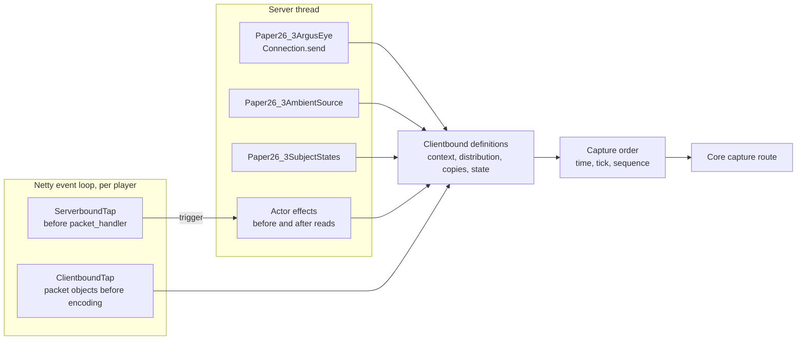
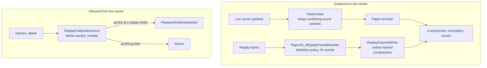

# Paper 26.3 adapter

The Paper 26.3 adapter implements the [version contract](../virtual-observer.md#version-contract)
for Minecraft 26.3. It owns everything that depends on the protocol: packet
definitions, the native codecs, the Argus eye, world snapshots and the hooks
the shared Paper base in `paper-common` calls for capture, playback and
checkpoints (see [architecture](../architecture.md#shared-paper-base-and-version-modules)).
This document describes its boundaries and lists the policy of every packet.

## Runtime baseline

| Item | Value |
|---|---|
| Server | Paper `26.3.build.263-stable` |
| Java | 26 |
| Netty | 4.2.16, as shipped with Paper |
| Protocol version | 777 |
| Adapter ID | `paper-26.3` |
| Adapter format revision | 5 |

Version-bound NMS access stays inside
`dev.voldechse.replayframework.adapter.paper.v26_3`.

The registry fingerprint is derived at runtime from the live protocol
registry: phase, direction, ID, type name and codec of every packet. Capture
and playback policy are not part of it, so a policy change never locks out
existing replays; playback always applies the current policy. A replay is
playable when its adapter ID, format revision and fingerprint match.

## Differences to the 26.2 adapter

The adapter implements every 26.3 packet with its own definition; it shares
no code with the 26.2 adapter, only `paper-common`. Where 26.3 differs from
26.2:

| Area | 26.3 |
|---|---|
| Packet IDs | 104 clientbound and 17 serverbound PLAY packets have other IDs; classes are named by the 26.3 IDs |
| New packets | clientbound `add_transient_block`, `post_effects` (PLAY and CONFIGURATION), `swing_animation`; serverbound `punch` replaces `swing` |
| Relative movement | `move_entity_pos` and `move_entity_pos_rot` carry a `VecDelta`, linear or a list of steps each relative to the previous one; the step count is packed into the ground-flag VarInt. Capture and the scene decoder use the sum of all steps (`Paper26_3MovementDeltas`). `move_entity_rot` writes the ground flag before the rotations |
| Position sync | `entity_position_sync` holds a `PositionPath` (one position or steps with tick offsets) and the rotations; it no longer carries a delta movement. The scene uses the end of the path |
| Arm swings | `animate` keeps wake-up and critical hits (renumbered 0 to 2); arm swings are `swing_animation` |
| Particles | `level_particles` has a maximum speed per axis and a randomization type; the particle is written first and the count as a VarInt |
| Explosion | `explode` has a `playSound` flag |
| Bit sets | `ByteBufCodecs.BIT_SET` writes a byte array instead of a long array (light masks) |
| Records | chunk with light, light update, remove entities, open book, open sign editor (`SignTextSlot`), update advancements (`PositionedAdvancement`), use item on and others are records with accessor names |
| Enum fallbacks | unknown IDs of chat completion actions, hands and sign sides decode to the first value instead of failing; a negative entity count in `remove_entities` fails |
| Level events | event 2001 (block broken by an entity, with sound) is `PARTICLES_AND_SOUND_DESTROY_BLOCK`; `PARTICLES_DESTROY_BLOCK` is 2014 (particles only). The block break actor effect sends 2001 |
| Player actions | `player_action` has the new action `CHANGE_DESTROY_DIRECTION`, which triggers nothing |
| Spawn info | the previous game type is an `Optional`, written as an optional VarInt |
| Snapshots | `ServerEntity` takes an `UpdateInterval` |

## Packages

`Paper26_3ReplayAdapter` is the entry point and `Paper26_3AdapterProvider`
exposes it to adapter discovery.

| Package | Owns |
|---|---|
| `packet` | protocol discovery (`Paper26_3ProtocolIntrospector` reads the live registries into the shared `ProtocolSnapshot`; `Paper26_3PacketRegistry` validates it with the shared `PaperPacketRegistry` against the 26.3 catalog), the native codec and every packet definition, split into `packet.clientbound` and `packet.serverbound` |
| `argus` | the eye (`Paper26_3ArgusEye`), sampled time and weather (`Paper26_3AmbientSource`), sampled entity state (`Paper26_3SubjectStates`) and the platform queries Argus needs |
| `actor` | effects the server sends to everyone except the acting player, derived from serverbound packets |
| `capture` | `Paper26_3CaptureHooks`, the version half of the shared `PaperCaptureBridge`: live codec, definitions, connection identity, Paper's connection hook, the serverbound identifier and the actor effects |
| `checkpoint` | `Paper26_3SnapshotProvider` and `Paper26_3NativePacketCodec`, the version half of the shared `CheckpointAssembler`: snapshots of a coverage, the capture barrier that separates them from later frames, and their encoding |
| `playback` | rewriting, the viewer gate, injection, view reset, scene queries and interactions |

Definition naming and placement follow
[packet definition layout](../packet-definition-layout.md).

## Capture

- **Eyes** hand packet objects to Argus on the server thread before any
  encoding. Argus merges them and passes them through their clientbound
  definition to obtain their capture context.
- **Player connections** are observed by a `ClientboundTap` (shared, in
  `paper-common`) directly before the server's `packet_handler`, the tail of
  the pipeline. It sees every packet object before it is encoded and hands
  the packets of a bundle over one by one; the packet is encoded once, for
  the frame. Packets whose definition is not observable by eyes are
  tagged `PLAYER_ONLY`; packets that describe their recipient get the player
  as subject.
- **Serverbound packets** are seen as decoded objects by a `ServerboundTap`
  (shared, in `paper-common`) directly before the server's packet handler.
  The tap never changes, drops or delays a packet. A serverbound definition
  decides whether its packet triggers an actor effect; `Paper26_3ActorEffects`
  queues the reads around it on the server thread.

Every path publishes through one capture-order allocator, so timestamps,
ticks, sequences and checkpoint barriers form one order.

## Checkpoints

A checkpoint covers the watch's current coverage. `PRELOAD_SCOPE` loads the
covered chunks first; `LOADED_ONLY` takes only chunks that are loaded. The
snapshot is taken on the server thread, and the capture barrier is allocated
only after it is ready. The core drains every frame ordered before the
barrier before it writes the checkpoint, so the snapshot and the following
frames never overlap.

Snapshot data is converted to native packets before it leaves the server
thread. The shared `CheckpointAssembler` in `paper-common` then orders them by
family (dimension, chunks, block entities, global state, entities and their
metadata), world and target, checks each against the registry and its
definition, and numbers the frames. The checkpoint of a `STATE` track is the complete state of
its subject, built from the same packets a client receives on join or when
opening the subject.

## Playback

| Class | Responsibility |
|---|---|
| `PaperPlaybackBridge` (shared) | the session's bridge: lifecycle, the frame pipeline (registry decision, scene, world filter, rewrite, write) and the queries; version parts come from `Paper26_3PlaybackHooks` |
| `ViewerOutboundQueue` (shared) | runs frames and resets in order on the connection's event loop, at most 128 per turn, with one flush per turn and waiters for an idle queue |
| `Paper26_3ReplayPacketRewriter` | applies each definition's playback policy and rewrites entity IDs and UUIDs into a session-local identity space |
| `ReplayChannelWriter` (shared) | writes encoded replay packets from an anchor behind `compress` (or `prepender`), skipping the gate, the clientbound tap and the server's encoder, but keeping compression, framing and encryption |
| `ViewerGate` (shared) | suppresses live scene packets that would conflict with the replay; classifies the packet object by its definition, without encoding it; passes the viewer's own state and user interface |
| `Paper26_3PlaybackHooks` | the 26.3 parts of a viewer: live codec, classification of live packets by type, rewriter, resetter, scene, interaction handler |
| `Paper26_3ViewerScene` | the shared `SceneModel` with the 26.3 scene decoder, the state decoders and the observer anchors of a viewer |
| `Paper26_3ViewResetter` | removes replay-owned boss bars, tab entries, entities and block cracks on reset and close |
| `Paper26_3SceneDecoder` | turns played frames into the changes of the shared `SceneModel`, which keeps type, position, name, health, equipment, effects and flags of every replay entity and the containers with recorded contents |
| `Paper26_3SubjectStateDecoder` | decodes a state track's packets into a `SubjectState` |
| `Paper26_3BlockStateDecoder` | builds a container's contents from the block state track |
| `ReplayEntityInteractions` | consumes `interact` and `attack` packets aimed at replay entities and `use_item_on` packets aimed at recorded containers |

Replay packets are never recaptured, because they enter the pipeline head-side
of the clientbound tap.

A live `respawn` lifts the gate's isolation, so the viewer's client receives
the new world's live chunks after a world change. Isolation resumes with the
next view rebuild.

Seek reconstruction emits only packets marked checkpoint-relevant. Sounds,
particles, animations and other transient packets are sent during normal
playback at their recorded time but are not replayed as a burst after a
seek.

## Compatibility and limits

The adapter requires the pinned Paper protocol and compatible registries.
Custom server software, modified registries, datapacks or protocol
translators can invalidate assumptions even when the nominal game version
matches.

Only semantics the adapter models explicitly are transformed. Opaque or
unknown values are never guessed from field shape, packet names or payload
bytes. The registry fingerprint is a compatibility guard, not a substitute
for validating custom runtime content.

## Quality assurance

Every clientbound and serverbound definition has a test against the live
registry. Further tests cover the native codec, capture ordering, Argus
platform behavior, effect families, checkpoints, rewriting, the outbound
gate, view reset, the scene entity tracker, the subject state decoder and
entity interactions. Tests run against the pinned Paper development bundle,
so IDs, codecs and native types match the version used for compilation.

## Argus measurements

Not measured on 26.3 yet.

## Protocol inventory

### STATUS, LOGIN and CONFIGURATION

Packets of these phases set up or manage a connection. None of them is
recorded or ever injected into an established PLAY connection:

- **STATUS:** `status_response`, `pong_response`.
- **LOGIN:** `login_disconnect`, `hello`, `login_finished`,
  `login_compression`, `custom_query`, `cookie_request`.
- **CONFIGURATION:** `cookie_request`, `custom_payload`, `disconnect`,
  `finish_configuration`, `keep_alive`, `ping`, `reset_chat`,
  `registry_data`, `resource_pack_pop`, `resource_pack_push`,
  `store_cookie`, `transfer`, `update_enabled_features`, `update_tags`,
  `select_known_packs`, `custom_report_details`, `server_links`,
  `clear_dialog`, `show_dialog`, `code_of_conduct`, `post_effects`.

### PLAY clientbound

Every PLAY clientbound packet has exactly one definition. The table is
generated from the definitions' declarations.

| Column | Values |
|---|---|
| Category | `stateful`: restores state; `ephemeral`: an event at one moment; `configurable`: recorded according to the `CapturePolicy`; `control`: connection management |
| Playback | `replayed`; `replayed, IDs rewritten` into the session's identity space; `viewer-local`: never applied to the viewer's client; `blocked`: rejected |
| Checkpoint | whether checkpoints contain it and seeks rebuild it |
| Source | `eye, broadcast` and `eye, membership`: from the eyes, see [merging](../virtual-observer.md#one-scene-from-many-eyes); `view-local`: one view's own state, never recorded; `ears`: from player connections with the [recipient-copy](../capture-source-policy.md#recipient-copies) declaration, `world-wide` into the global track; `own state`: the recipient's state track |

| ID | Packet | Domain | Category | Playback | Checkpoint | Source | Notes |
|---:|---|---|---|---|---|---|---|
| 0 | `minecraft:bundle_delimiter` | connection | control | blocked | no | - | a bundle boundary; never injected into an established connection |
| 1 | `minecraft:add_entity` | entity | stateful | replayed, IDs rewritten | yes | eye, membership |  |
| 2 | `minecraft:animate` | effect | ephemeral | replayed, IDs rewritten | no | eye, broadcast |  |
| 3 | `minecraft:award_stats` | player | stateful | viewer-local | no | - |  |
| 4 | `minecraft:block_changed_ack` | world | control | blocked | no | - |  |
| 5 | `minecraft:block_destruction` | effect | ephemeral | replayed, IDs rewritten | no | ears, identical copies |  |
| 6 | `minecraft:block_entity_data` | world | stateful | replayed | yes | eye, broadcast | with complete data also the contents of containers, read by Argus into the block state track |
| 7 | `minecraft:block_event` | world | ephemeral | replayed | no | ears, identical copies |  |
| 8 | `minecraft:block_update` | world | stateful | replayed | yes | eye, broadcast |  |
| 9 | `minecraft:boss_event` | effect | stateful | replayed, IDs rewritten | yes | ears, identical copies |  |
| 10 | `minecraft:change_difficulty` | world | stateful | viewer-local | no | - |  |
| 11 | `minecraft:chunk_batch_finished` | connection | control | blocked | no | - |  |
| 12 | `minecraft:chunk_batch_start` | connection | control | blocked | no | - |  |
| 13 | `minecraft:chunks_biomes` | world | stateful | replayed | yes | eye, broadcast |  |
| 14 | `minecraft:clear_titles` | ui | stateful | viewer-local | no | - |  |
| 15 | `minecraft:command_suggestions` | ui | ephemeral | viewer-local | no | - |  |
| 16 | `minecraft:commands` | ui | stateful | viewer-local | no | - |  |
| 17 | `minecraft:container_close` | ui | stateful | viewer-local | no | - |  |
| 18 | `minecraft:container_set_content` | ui | stateful | viewer-local | no | - | the inventory is read every tick by Argus |
| 19 | `minecraft:container_set_data` | ui | stateful | viewer-local | no | - |  |
| 20 | `minecraft:container_set_slot` | ui | stateful | viewer-local | no | - | the inventory is read every tick by Argus |
| 21 | `minecraft:cookie_request` | connection | control | blocked | no | - |  |
| 22 | `minecraft:cooldown` | ui | stateful | viewer-local | no | - |  |
| 23 | `minecraft:custom_chat_completions` | chat | stateful | viewer-local | no | - |  |
| 24 | `minecraft:custom_payload` | connection | configurable | viewer-local | no | - |  |
| 25 | `minecraft:damage_event` | effect | ephemeral | replayed, IDs rewritten | no | eye, broadcast |  |
| 26 | `minecraft:debug/block_value` | diagnostic | control | blocked | no | - |  |
| 27 | `minecraft:debug/chunk_value` | diagnostic | control | blocked | no | - |  |
| 28 | `minecraft:debug/entity_value` | diagnostic | control | blocked | no | - |  |
| 29 | `minecraft:debug/event` | diagnostic | control | blocked | no | - |  |
| 30 | `minecraft:debug_sample` | diagnostic | control | blocked | no | - |  |
| 31 | `minecraft:delete_chat` | chat | ephemeral | viewer-local | no | - |  |
| 32 | `minecraft:disconnect` | connection | control | blocked | no | - |  |
| 33 | `minecraft:disguised_chat` | chat | ephemeral | replayed | no | ears, identical copies, world-wide | public chat only |
| 34 | `minecraft:entity_event` | effect | ephemeral | replayed, IDs rewritten | no | eye, broadcast |  |
| 35 | `minecraft:entity_position_sync` | entity | stateful | replayed, IDs rewritten | yes | eye, broadcast |  |
| 36 | `minecraft:explode` | effect | ephemeral | replayed, IDs rewritten | no | ears, keyed copies |  |
| 37 | `minecraft:add_transient_block` | world | ephemeral | replayed | no | eye, broadcast | new in 26.3: a falling block that cannot place itself shows its state briefly |
| 38 | `minecraft:forget_level_chunk` | world | stateful | replayed | yes | eye, membership |  |
| 39 | `minecraft:game_event` | world | ephemeral | replayed | no | ears, from Argus, copies dropped | weather and other game events; weather is sampled by Argus |
| 40 | `minecraft:game_rule_values` | world | stateful | viewer-local | no | - |  |
| 41 | `minecraft:game_test_highlight_pos` | diagnostic | control | blocked | no | - |  |
| 42 | `minecraft:mount_screen_open` | ui | stateful | viewer-local | no | - |  |
| 43 | `minecraft:hurt_animation` | effect | ephemeral | replayed, IDs rewritten | no | eye, broadcast |  |
| 44 | `minecraft:initialize_border` | world | stateful | replayed | yes | ears, identical copies |  |
| 45 | `minecraft:keep_alive` | connection | control | blocked | no | - |  |
| 46 | `minecraft:level_chunk_with_light` | world | stateful | replayed | yes | eye, membership |  |
| 47 | `minecraft:level_event` | world | ephemeral | replayed | no | ears, keyed copies |  |
| 48 | `minecraft:level_particles` | effect | ephemeral | replayed, IDs rewritten | no | ears, identical copies |  |
| 49 | `minecraft:light_update` | world | stateful | replayed | yes | eye, broadcast |  |
| 50 | `minecraft:login` | connection | control | blocked | no | - |  |
| 51 | `minecraft:low_disk_space_warning` | ui | ephemeral | viewer-local | no | - |  |
| 52 | `minecraft:map_item_data` | world | stateful | viewer-local | no | - |  |
| 53 | `minecraft:merchant_offers` | ui | stateful | viewer-local | no | - |  |
| 54 | `minecraft:move_entity_pos` | entity | stateful | replayed, IDs rewritten | yes | eye, broadcast | a relative step; seeks replay it |
| 55 | `minecraft:move_entity_pos_rot` | entity | stateful | replayed, IDs rewritten | yes | eye, broadcast | a relative step; seeks replay it |
| 56 | `minecraft:move_minecart_along_track` | entity | stateful | replayed, IDs rewritten | yes | eye, broadcast |  |
| 57 | `minecraft:move_entity_rot` | entity | stateful | replayed, IDs rewritten | yes | eye, broadcast | a relative step; seeks replay it |
| 58 | `minecraft:move_vehicle` | entity | ephemeral | viewer-local | no | - |  |
| 59 | `minecraft:open_book` | ui | ephemeral | viewer-local | no | - |  |
| 60 | `minecraft:open_screen` | ui | ephemeral | viewer-local | no | - |  |
| 61 | `minecraft:open_sign_editor` | ui | ephemeral | viewer-local | no | - |  |
| 62 | `minecraft:ping` | connection | control | blocked | no | - |  |
| 63 | `minecraft:pong_response` | connection | control | blocked | no | - |  |
| 64 | `minecraft:place_ghost_recipe` | ui | ephemeral | viewer-local | no | - |  |
| 65 | `minecraft:player_abilities` | player | stateful | viewer-local | no | - |  |
| 66 | `minecraft:player_chat` | chat | configurable | replayed | no | ears, keyed copies, world-wide | replayed as `disguised_chat`; whispers and team messages are not recorded |
| 67 | `minecraft:player_combat_end` | player | ephemeral | viewer-local | no | - |  |
| 68 | `minecraft:player_combat_enter` | player | ephemeral | viewer-local | no | - |  |
| 69 | `minecraft:player_combat_kill` | player | ephemeral | viewer-local | no | - |  |
| 70 | `minecraft:player_info_remove` | player | stateful | replayed, IDs rewritten | yes | ears, identical copies, world-wide | tab list |
| 71 | `minecraft:player_info_update` | player | stateful | replayed, IDs rewritten | yes | ears, identical copies, world-wide | tab list and player profiles |
| 72 | `minecraft:player_look_at` | player | ephemeral | viewer-local | no | - |  |
| 73 | `minecraft:player_position` | player | stateful | viewer-local | no | - |  |
| 74 | `minecraft:player_rotation` | player | stateful | viewer-local | no | - |  |
| 75 | `minecraft:recipe_book_add` | ui | stateful | viewer-local | no | - |  |
| 76 | `minecraft:recipe_book_remove` | ui | stateful | viewer-local | no | - |  |
| 77 | `minecraft:recipe_book_settings` | ui | stateful | viewer-local | no | - |  |
| 78 | `minecraft:remove_entities` | entity | stateful | replayed, IDs rewritten | yes | eye, membership |  |
| 79 | `minecraft:remove_mob_effect` | effect | stateful | replayed, IDs rewritten | yes | eye, broadcast |  |
| 80 | `minecraft:reset_score` | scoreboard | stateful | viewer-local | no | - |  |
| 81 | `minecraft:resource_pack_pop` | connection | control | blocked | no | - |  |
| 82 | `minecraft:resource_pack_push` | connection | control | blocked | no | - |  |
| 83 | `minecraft:post_effects` | player | stateful | viewer-local | no | - | new in 26.3: the player's own screen post effects, sent only to that player |
| 84 | `minecraft:respawn` | player | stateful | viewer-local | no | - |  |
| 85 | `minecraft:rotate_head` | entity | stateful | replayed, IDs rewritten | yes | eye, broadcast |  |
| 86 | `minecraft:section_blocks_update` | world | stateful | replayed | yes | eye, broadcast |  |
| 87 | `minecraft:select_advancements_tab` | ui | ephemeral | viewer-local | no | - |  |
| 88 | `minecraft:server_data` | ui | stateful | viewer-local | no | - |  |
| 89 | `minecraft:set_action_bar_text` | ui | ephemeral | viewer-local | no | - |  |
| 90 | `minecraft:set_border_center` | world | stateful | replayed | yes | ears, identical copies |  |
| 91 | `minecraft:set_border_lerp_size` | world | stateful | replayed | yes | ears, identical copies |  |
| 92 | `minecraft:set_border_size` | world | stateful | replayed | yes | ears, identical copies |  |
| 93 | `minecraft:set_border_warning_delay` | world | stateful | replayed | yes | ears, identical copies |  |
| 94 | `minecraft:set_border_warning_distance` | world | stateful | replayed | yes | ears, identical copies |  |
| 95 | `minecraft:set_camera` | player | stateful | viewer-local | no | - |  |
| 96 | `minecraft:set_chunk_cache_center` | world | stateful | viewer-local | no | view-local |  |
| 97 | `minecraft:set_chunk_cache_radius` | world | stateful | viewer-local | no | view-local |  |
| 98 | `minecraft:set_cursor_item` | ui | stateful | viewer-local | no | - |  |
| 99 | `minecraft:set_default_spawn_position` | world | stateful | replayed | yes | ears, identical copies |  |
| 100 | `minecraft:set_display_objective` | scoreboard | stateful | viewer-local | no | - |  |
| 101 | `minecraft:set_entity_data` | entity | stateful | replayed, IDs rewritten | yes | eye, broadcast |  |
| 102 | `minecraft:set_entity_link` | entity | stateful | replayed, IDs rewritten | yes | eye, broadcast |  |
| 103 | `minecraft:set_entity_motion` | entity | stateful | replayed, IDs rewritten | yes | eye, broadcast |  |
| 104 | `minecraft:set_equipment` | entity | stateful | replayed, IDs rewritten | yes | eye, broadcast |  |
| 105 | `minecraft:set_experience` | player | stateful | viewer-local | no | own state |  |
| 106 | `minecraft:set_health` | player | stateful | viewer-local | no | own state |  |
| 107 | `minecraft:set_held_slot` | player | stateful | viewer-local | no | - | the selected slot is read every tick by Argus |
| 108 | `minecraft:set_objective` | scoreboard | stateful | viewer-local | no | - |  |
| 109 | `minecraft:set_passengers` | entity | stateful | replayed, IDs rewritten | yes | eye, broadcast |  |
| 110 | `minecraft:set_player_inventory` | ui | stateful | viewer-local | no | - | the inventory is read every tick by Argus |
| 111 | `minecraft:set_player_team` | scoreboard | stateful | viewer-local | no | - |  |
| 112 | `minecraft:set_score` | scoreboard | stateful | viewer-local | no | - |  |
| 113 | `minecraft:set_simulation_distance` | world | stateful | replayed | yes | view-local |  |
| 114 | `minecraft:set_subtitle_text` | ui | stateful | viewer-local | no | - |  |
| 115 | `minecraft:set_time` | world | stateful | replayed | yes | ears, from Argus, copies dropped | sampled by Argus |
| 116 | `minecraft:set_title_text` | ui | stateful | viewer-local | no | - |  |
| 117 | `minecraft:set_titles_animation` | ui | stateful | viewer-local | no | - |  |
| 118 | `minecraft:sound_entity` | effect | ephemeral | replayed, IDs rewritten | no | ears, identical copies |  |
| 119 | `minecraft:sound` | effect | ephemeral | replayed | no | ears, identical copies |  |
| 120 | `minecraft:start_configuration` | connection | control | blocked | no | - |  |
| 121 | `minecraft:stop_sound` | effect | ephemeral | replayed | no | ears, identical copies |  |
| 122 | `minecraft:store_cookie` | connection | control | blocked | no | - |  |
| 123 | `minecraft:swing_animation` | effect | ephemeral | replayed, IDs rewritten | no | eye, broadcast | new in 26.3: arm swings, which left `animate` |
| 124 | `minecraft:system_chat` | chat | configurable | replayed | no | ears, identical copies, world-wide | death, join, quit and advancement broadcasts only |
| 125 | `minecraft:tab_list` | ui | stateful | viewer-local | no | - |  |
| 126 | `minecraft:tag_query` | diagnostic | control | blocked | no | - |  |
| 127 | `minecraft:take_item_entity` | effect | ephemeral | replayed, IDs rewritten | no | eye, broadcast |  |
| 128 | `minecraft:teleport_entity` | entity | stateful | replayed, IDs rewritten | yes | eye, broadcast |  |
| 129 | `minecraft:test_instance_block_status` | diagnostic | control | blocked | no | - |  |
| 130 | `minecraft:ticking_state` | connection | control | blocked | no | - |  |
| 131 | `minecraft:ticking_step` | connection | control | blocked | no | - |  |
| 132 | `minecraft:transfer` | connection | control | blocked | no | - |  |
| 133 | `minecraft:update_advancements` | player | stateful | viewer-local | no | - |  |
| 134 | `minecraft:update_attributes` | entity | stateful | replayed, IDs rewritten | yes | eye, broadcast |  |
| 135 | `minecraft:update_mob_effect` | effect | stateful | replayed, IDs rewritten | yes | eye, broadcast |  |
| 136 | `minecraft:update_recipes` | ui | stateful | viewer-local | no | - |  |
| 137 | `minecraft:update_tags` | world | stateful | viewer-local | no | - |  |
| 138 | `minecraft:projectile_power` | entity | stateful | replayed, IDs rewritten | yes | eye, broadcast |  |
| 139 | `minecraft:custom_report_details` | connection | control | blocked | no | - |  |
| 140 | `minecraft:server_links` | ui | stateful | viewer-local | no | - |  |
| 141 | `minecraft:waypoint` | ui | stateful | viewer-local | no | - |  |
| 142 | `minecraft:clear_dialog` | ui | stateful | viewer-local | no | - |  |
| 143 | `minecraft:show_dialog` | ui | stateful | viewer-local | no | - |  |

### PLAY serverbound

Serverbound packets are never recorded or replayed. Each has a definition in
`packet.serverbound.definition.<domain>` that decides what it triggers:

- **nothing**: whatever the packet changes reaches the recording as
  clientbound packets, including the sender's own entity, which the eye that
  follows the sender tracks;
- **actor effect**: the server answers the packet with an effect it sends to
  everyone except the sender, which is derived for the recording (see
  [capture source policy](../capture-source-policy.md#effects-that-bypass-their-actor)).

The definitions describe recording. During playback, a viewer's `interact`
and `attack` packets aimed at replay entities are consumed by
`ReplayEntityInteractions` before they reach the server; see
[playback](#playback).

| ID | Identifier | Domain | Triggers | Reason |
|---:|---|---|---|---|
| 0 | `minecraft:accept_teleportation` | player | nothing | Confirms a server-side teleport. Whatever it changes about the sender's own entity reaches the recording through the entity tracker of the eye that follows the sender. |
| 1 | `minecraft:attack` | entity | nothing | Attacks an entity. Hit, critical and sweep sounds, the damage event and the victim's reaction reach every recipient, including the attacker. Known gap: a piercing weapon (spear) plays its sound to everyone except the attacker; it is not derived yet. |
| 2 | `minecraft:block_entity_tag_query` | diagnostic | nothing | Debug query for block-entity data. Changes nothing. |
| 3 | `minecraft:bundle_item_selected` | inventory | nothing | Selects a slot inside a bundle. Inventory state of the sender only. |
| 4 | `minecraft:change_difficulty` | player | nothing | Changes the difficulty. The server announces the result with a clientbound change_difficulty packet to every player. |
| 5 | `minecraft:change_game_mode` | player | nothing | Switches the sender's game mode. Every player receives the result as a clientbound player_info_update. |
| 6 | `minecraft:chat_ack` | chat | nothing | Acknowledges received chat messages for the signature chain. Connection state only. |
| 7 | `minecraft:chat_command` | chat | nothing | Runs an unsigned command. Whatever the command changes reaches the recording as clientbound packets. |
| 8 | `minecraft:chat_command_signed` | chat | nothing | Runs a signed command. Whatever the command changes reaches the recording as clientbound packets. |
| 9 | `minecraft:chat` | chat | nothing | Sends a chat message. The server sends the message to every recipient, including the sender. |
| 10 | `minecraft:chat_session_update` | chat | nothing | Publishes the sender's chat key. Other players receive it as a clientbound player_info_update. |
| 11 | `minecraft:chunk_batch_received` | connection | nothing | Reports the client's chunk throughput. Connection state only. |
| 12 | `minecraft:client_command` | player | nothing | Requests a respawn or statistics. A respawn reaches the recording through the clientbound respawn sequence. |
| 13 | `minecraft:client_tick_end` | connection | nothing | Ends one client tick. Connection state only. |
| 14 | `minecraft:client_information` | connection | nothing | Language, view distance, skin parts and main hand. Skin parts and main hand reach other recipients as entity metadata through the tracker. |
| 15 | `minecraft:command_suggestion` | chat | nothing | Requests tab completion. Changes nothing. |
| 16 | `minecraft:configuration_acknowledged` | connection | nothing | Confirms the switch into the configuration phase. Connection state only. |
| 17 | `minecraft:container_button_click` | inventory | nothing | Clicks a menu button such as an enchantment option, loom pattern or stonecutter recipe. Resulting sounds are sent to every player. |
| 18 | `minecraft:container_click` | inventory | nothing | Moves items in an open container. Whatever it changes about the sender's own entity reaches the recording through the entity tracker of the eye that follows the sender. |
| 19 | `minecraft:container_close` | inventory | nothing | Closes a container. Chest, barrel and shulker box sounds and lid animations are sent to every player. |
| 20 | `minecraft:container_slot_state_changed` | inventory | nothing | Toggles a crafter slot. The block change is sent as a clientbound block update. |
| 21 | `minecraft:cookie_response` | connection | nothing | Answers a cookie request. Connection state only. |
| 22 | `minecraft:custom_payload` | connection | nothing | Plugin channel message. Whatever a plugin changes in response reaches the recording as clientbound packets. |
| 23 | `minecraft:debug_subscription_request` | diagnostic | nothing | Subscribes to debug data. Changes nothing in the scene. |
| 24 | `minecraft:edit_book` | inventory | nothing | Edits a book in the sender's inventory. Not part of the scene. |
| 25 | `minecraft:entity_tag_query` | diagnostic | nothing | Debug query for entity data. Changes nothing. |
| 26 | `minecraft:interact` | entity | nothing | Uses or aims at an entity. Most results reach the recording as clientbound packets. Known gap: igniting a creeper, giving an item to an allay, dyeing a sheep, waxing or scraping a copper golem and milking play their sound to everyone except the sender; they are not derived yet. |
| 27 | `minecraft:jigsaw_generate` | diagnostic | nothing | Generates a jigsaw structure. The placed blocks are sent as clientbound block updates. |
| 28 | `minecraft:keep_alive` | connection | nothing | Answers a keep-alive. Connection state only. |
| 29 | `minecraft:lock_difficulty` | player | nothing | Locks the difficulty. A setting, not part of the scene. |
| 30 | `minecraft:move_player_pos` | player | nothing | Moves the sender. Whatever it changes about the sender's own entity reaches the recording through the entity tracker of the eye that follows the sender. Known gap: step, swim, splash and landing sounds are played to everyone except the sender; they are not derived yet. |
| 31 | `minecraft:move_player_pos_rot` | player | nothing | Moves and turns the sender. Whatever it changes about the sender's own entity reaches the recording through the entity tracker of the eye that follows the sender. Known gap: step, swim, splash and landing sounds are played to everyone except the sender; they are not derived yet. |
| 32 | `minecraft:move_player_rot` | player | nothing | Turns the sender. Whatever it changes about the sender's own entity reaches the recording through the entity tracker of the eye that follows the sender. |
| 33 | `minecraft:move_player_status_only` | player | nothing | Reports ground and wall contact of the sender. Whatever it changes about the sender's own entity reaches the recording through the entity tracker of the eye that follows the sender. |
| 34 | `minecraft:move_vehicle` | player | nothing | Moves the vehicle the sender rides. The vehicle and its rider reach the recording through the entity tracker. |
| 35 | `minecraft:paddle_boat` | player | nothing | Reports paddle state. Paddle sounds are played to every player. |
| 36 | `minecraft:pick_item_from_block` | inventory | nothing | Picks the block's item into the hand. Whatever it changes about the sender's own entity reaches the recording through the entity tracker of the eye that follows the sender. |
| 37 | `minecraft:pick_item_from_entity` | inventory | nothing | Picks the entity's item into the hand. Whatever it changes about the sender's own entity reaches the recording through the entity tracker of the eye that follows the sender. |
| 38 | `minecraft:ping_request` | connection | nothing | Measures latency. Connection state only. |
| 39 | `minecraft:place_recipe` | inventory | nothing | Fills a crafting grid from the recipe book. Not part of the scene. |
| 40 | `minecraft:player_abilities` | player | nothing | Starts or stops creative flight. The resulting movement arrives with movement packets. |
| 41 | `minecraft:player_action` | world | actor effect | Digging, dropping items, releasing a used item, swapping hands and stabbing. Starting or finishing to dig can break a block; the server sends the break particles and sound to everyone except the digger, so this packet derives them. Everything else reaches the recording through the entity tracker. |
| 42 | `minecraft:player_command` | player | nothing | Sprinting, elytra flight, horse jumps, leaving a bed. The results are entity metadata sent through the tracker. |
| 43 | `minecraft:player_input` | player | nothing | Movement keys, sneaking and jumping. The results are entity metadata sent through the tracker. |
| 44 | `minecraft:player_loaded` | connection | nothing | Reports that the client finished loading. Connection state only. |
| 45 | `minecraft:pong` | connection | nothing | Answers a ping. Connection state only. |
| 46 | `minecraft:punch` | entity | nothing | New in 26.3, replaces `swing`: a left click that hits nothing. The arm swing reaches the trackers, including the eye that follows the sender, as `swing_animation`. |
| 47 | `minecraft:recipe_book_change_settings` | inventory | nothing | Changes recipe book settings. Not part of the scene. |
| 48 | `minecraft:recipe_book_seen_recipe` | inventory | nothing | Marks a recipe as seen. Not part of the scene. |
| 49 | `minecraft:rename_item` | inventory | nothing | Sets the anvil name. The anvil sound on taking the result is sent to every player. |
| 50 | `minecraft:resource_pack` | connection | nothing | Reports resource pack status. Connection state only. |
| 51 | `minecraft:seen_advancements` | ui | nothing | Opens an advancement tab. Not part of the scene. |
| 52 | `minecraft:select_trade` | inventory | nothing | Selects a merchant offer. Not part of the scene. |
| 53 | `minecraft:set_beacon` | inventory | nothing | Selects beacon effects. The beacon sound is sent to every player. |
| 54 | `minecraft:set_carried_item` | inventory | nothing | Selects a hotbar slot. Whatever it changes about the sender's own entity reaches the recording through the entity tracker of the eye that follows the sender. |
| 55 | `minecraft:set_command_block` | diagnostic | nothing | Configures a command block. Its block entity data is sent as a clientbound packet. |
| 56 | `minecraft:set_command_minecart` | diagnostic | nothing | Configures a command minecart. Its metadata is sent through the tracker. |
| 57 | `minecraft:set_creative_mode_slot` | inventory | nothing | Sets an inventory slot in creative mode. Whatever it changes about the sender's own entity reaches the recording through the entity tracker of the eye that follows the sender. |
| 58 | `minecraft:set_game_rule` | world | nothing | Changes a game rule. A setting; its effects reach the recording as clientbound packets. |
| 59 | `minecraft:set_jigsaw_block` | diagnostic | nothing | Configures a jigsaw block. Its block entity data is sent as a clientbound packet. |
| 60 | `minecraft:set_structure_block` | diagnostic | nothing | Configures a structure block. Its block entity data is sent as a clientbound packet. |
| 61 | `minecraft:set_test_block` | diagnostic | nothing | Configures a test block. Its block entity data is sent as a clientbound packet. |
| 62 | `minecraft:sign_update` | world | nothing | Sets the text of a sign. The sign's block entity data is sent to every player. |
| 63 | `minecraft:spectator_action` | player | nothing | Spectator teleport. Whatever it changes about the sender's own entity reaches the recording through the entity tracker of the eye that follows the sender. |
| 64 | `minecraft:teleport_to_entity` | player | nothing | Spectator teleport to an entity. Whatever it changes about the sender's own entity reaches the recording through the entity tracker of the eye that follows the sender. |
| 65 | `minecraft:test_instance_block_action` | diagnostic | nothing | Operates a test instance block. Its block entity data is sent as a clientbound packet. |
| 66 | `minecraft:use_item_on` | world | actor effect | Uses an item on a block face. Placing a block, opening a door, trapdoor or fence gate, pulling a lever and pressing a button play their sound to everyone except the sender, so this packet derives them. Known gap: tool, bucket, flint and steel, honeycomb, brush and comparator sounds are not derived yet. |
| 67 | `minecraft:use_item` | entity | nothing | Uses the held item in the air. Whatever it changes about the sender's own entity reaches the recording through the entity tracker of the eye that follows the sender. Known gap: bucket and bottle filling, goat horns, lance sounds and eating or drinking are played to everyone except the sender; they are not derived yet. |
| 68 | `minecraft:custom_click_action` | connection | nothing | Clicks a custom dialog action. Whatever a plugin changes in response reaches the recording as clientbound packets. |
