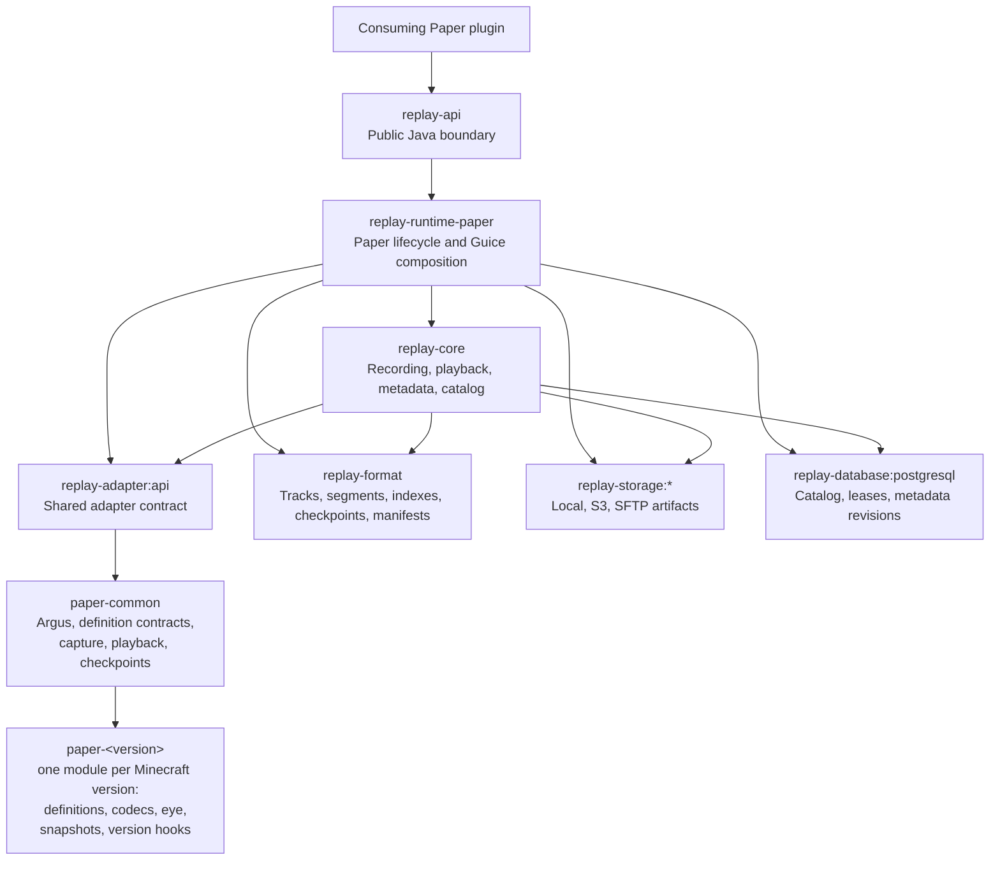
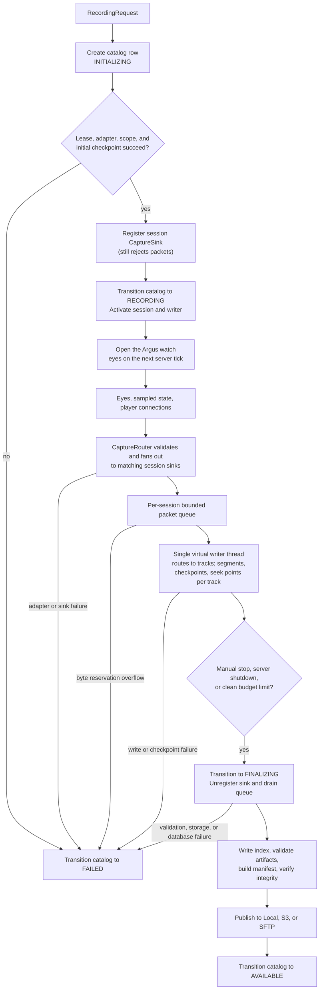
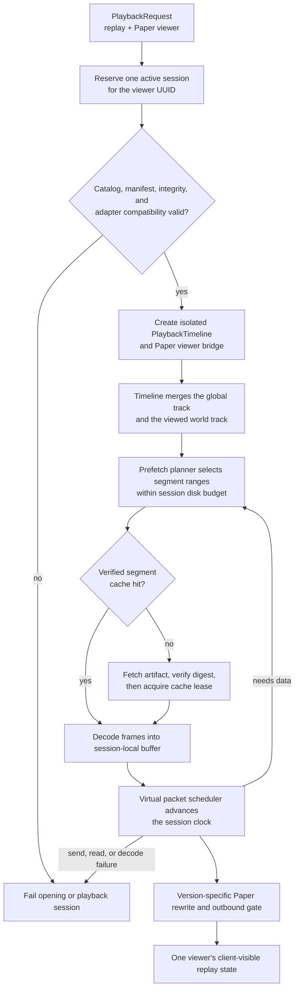

# Architecture

Replay Framework is a layered, multi-module Paper integration. The public API
isolates consuming plugins from the packet adapter, artifact format, storage,
and PostgreSQL persistence details.

## Module boundaries

Only `replay-api` is an integration dependency. The runtime selects and opens
the adapter matching the server's Minecraft version, constructs the dependency
graph with Guice, runs Flyway before
Hibernate, then publishes a `ReplayFramework` facade to Paper's
`ServicesManager` and `ReplayFrameworkProvider`.

### Shared Paper base and version modules

Everything that works the same on every Paper version lives in
`paper-common`, which may use the Paper API and Netty but no Minecraft server
classes. A version module implements small hooks for what really differs: the
packet definitions, the codec of its protocol and its access to the server.

| `paper-common` package | Owns | Hook a version implements |
|---|---|---|
| `argus` | virtual observers, scene merge, sampled state and block states | the eye and the platform queries |
| `channel` | the clientbound tap before `packet_handler` and the write anchor behind compression | none |
| `capture` | `PaperCaptureBridge`: taps, capture order, Argus publishing, state routing, failures | `CaptureHooks`: codec, connection identity, Paper's connection hook, serverbound identifier, actor effects |
| `playback` | `PaperPlaybackBridge`, `ViewerOutboundQueue`, `ViewerGate`: lifecycle, frame pipeline, world filter, batching, live isolation | `PlaybackHooks` with `ViewerParts`: codec, rewriter, view reset, scene; `SceneDecoder` for the shared `SceneModel` |
| `checkpoint` | `CheckpointAssembler`: order, validation and numbering of checkpoint packets | `SnapshotSource` and `CheckpointCodec` |
| `packet` | definition base classes, catalogs, recipient copies and state, capture context helpers | the definitions themselves |
| `protocol` | `ProtocolSnapshot` and `PaperPacketRegistry`: validates the live clientbound registries against the adapter's catalog (every PLAY packet has exactly one definition with the live ID) and builds the packet registry | reading the live registries into a `ProtocolSnapshot`; the Minecraft version, codec key prefix and catalog |

Each version module implements every packet of its version itself: its own
definition class per packet, its own hooks and its own tests. Version modules
share no code with each other, only `paper-common`. The
[adapter index](adapters/README.md) lists the version modules and describes
what an adapter implements; each adapter has its own document.

## Recording data flow

The scene of a recording comes from its own [virtual observers](virtual-observer.md):
eyes the server serves like neutral players, merged into one scene per world.
Packets only real players receive, such as sounds and chat, are captured from
their connections by a channel handler at the tail of each connection's
pipeline, which sees every packet object before the server encodes it. The
core routes every captured packet to each matching
recording session, so overlapping scopes remain isolated, and within a session
to one of its [tracks](recording-tracks.md). A bounded queue prevents capture pressure from becoming
unbounded memory use. Segment rotation, checkpoints, and finalization are
internal mechanics; the public `RecordingSession` intentionally exposes only
progress inspection and `stop()`.

Artifacts are not published as playable until the finalizer drains queued data,
writes the required index and manifest, verifies integrity, and completes the
storage publication. Any failure in that chain produces `FAILED` instead of an
available partial recording.

The central `CaptureRouter` is deliberately lightweight because adapter capture
callbacks arrive synchronously on Netty's event loop. It looks up a registered
clientbound packet descriptor, rejects disallowed packets, creates a defensive
captured-packet value, and reads an atomic snapshot of active session sinks.
Registration uses a short lock, but delivery never waits for registration or
another session. A failure in one sink removes and fails only that recording;
the first fatal adapter failure is reported separately for all active sessions.

Each accepted sink owns a bounded multi-producer/single-consumer queue. A
producer reserves the packet payload bytes before publishing its entry, so a
queue overflow cannot be mistaken for a captured packet and is never silently
dropped. Producers never wait for writer capacity. The session instead fails
with `QUEUE_OVERFLOW`, protecting the server from unbounded capture pressure.
One virtual writer thread is the only owner of the session's format writers and
artifact lists; it drains the queue, rotates segments, consumes checkpoint
signals, and seals the artifacts after admission closes.

In the core, the `RecordingCoordinator` owns the registry of active
recordings, shutdown, finalization and the failures that end a recording. A
start runs as a `RecordingInitialization`, one step per asynchronous port:
create the catalog row, take the lease, verify the adapter and resolve the
scope, encode the initial checkpoint, register the session, move the catalog
to RECORDING, activate the session and start its writer. `SceneWatches` keeps
the virtual observers of each recording and the scope its checkpoints cover;
`RecordingFailures` publishes failure events, releases the lease and moves
the catalog row to FAILED. The writer, `RecordingSegmentAppender`, keeps its
tracks in a `TrackSet`, where a track created late gets empty checkpoints
for the earlier barriers, and writes each checkpoint barrier through a
`CheckpointBarrierWriter`, which checks the adapter's capture against its
capture point before it reaches the tracks.

## Playback data flow

Each viewer receives a dedicated session. The playback engine reads the global
track and the track of the viewed world; other world tracks and state tracks
are read only when an integration queries players or subject state. Within those
tracks it reads only the required replay ranges, maintains a session-local decoded buffer, and uses the
shared disk segment cache within configured limits. Seeking begins from the
nearest checkpoint at or before the target, then replays deltas through that
position. A virtual playback worker schedules due frames according to the
session's own clock and speed.

The Paper adapter owns packet-level viewer isolation. A version catalog binds
every supported PLAY packet to exactly one definition. The definition applies
DROP/BLOCK policy before decode and otherwise owns the validated
decode/read/rewrite/rebuild/encode flow. Rebuilt bytes are written from an
anchor handler directly behind the connection's compression, which skips the
replay gate, the server's encoder and every handler other plugins placed
around it while keeping compression, length framing and encryption.
Application UX remains
outside the framework: integrations decide where a viewer stands, what controls
exist, and when normal player state is restored.

The core talks to a viewer through `PlaybackBridge`, which is made of role
interfaces, each used by the part of the core that needs it:

| Role | Methods | Used by |
|---|---|---|
| `ViewerStream` | frames, batches, view reset, isolation, the outbound queue | `PacketScheduler`, `SeekEngine` |
| `ViewerWorld` | the recorded world the viewer watches | `PlaybackTimeline` |
| `SceneQueries` | entities, players, observer anchors | `SceneTracks`, `PlaybackTimeline` |
| `StateDecoder` | subject and block state | `StateTracks` |
| `ViewerInteractions` | the viewer's clicks on entities and blocks | `SessionAssembly` |

The roles have no default methods, so an adapter states every capability
explicitly, and a new capability becomes a role of its own.

Playback opening reserves the viewer UUID before asynchronous work begins, so a
viewer cannot acquire two concurrent sessions while catalog and artifact work
is in flight. The runtime then verifies the replay artifact and adapter
boundary, creates the viewer bridge, and registers the session only after that
reservation exists. Terminal cleanup releases the session and viewer
reservation together.

`DefaultPlaybackService` reserves, loads and verifies; a `SessionAssembly`
builds the session in named steps: prepare and open the scene tracks, open
the bridge, build the timeline, wire up state tracks and interactions, place
the viewer, register. Every track is opened by one `TrackOpener`, which
checks its index, segments and checkpoints before it builds a buffer; the
scene prepares all its tracks before opening any, and state tracks open on
demand through the same opener.

The `PlaybackBuffer` asks the prefetch planner for ranges around the timeline
position. It retains data behind the viewer, preloads data ahead, scales the
forward window for the selected speed, and keeps the plan within the
session-local disk budget. `DiskSegmentCache` serves only complete,
integrity-checked immutable segments: a cache miss fetches to an inflight path,
verifies the digest, then atomically promotes a cacheable result. Each playback
session receives leases for the segments it uses, preventing an active segment
from being evicted.

Frame emission is driven by a virtual scheduler. It obtains decoded ranges from
the session-local buffer, orders frames by elapsed time, server tick, and
sequence number, and sends only frames after its cursor. If a needed range is
not immediately available, it pauses the clock and enters `BUFFERING`; when
the minimum resume window is available, it resumes only if the viewer still has
play intent. This separates the user's requested state from transient storage
latency.

## Catalog and metadata

PostgreSQL is the source of truth for replay lifecycle state, fixed replay
fields, typed metadata JSON, revision history, and recording leases. The
artifact backend is the source of replay payload bytes. The framework records
the selected backend and storage key with each catalog entry.

Metadata values are registered at runtime through typed keys. The core owns
conversion between typed API values and JSON; the repository owns the atomic
database transaction. Every committed metadata change stores a complete,
immutable snapshot in `metadata_revision`, enabling revision-aware audit and
recovery workflows.

## Lifecycle ownership

The Paper runtime is the only component that creates, installs, and shuts down
the framework facade. During shutdown it stops new recordings, attempts clean
recording finalization, closes playback sessions, releases leases, and then
closes shared cache, storage, and database resources in dependency order.

Consuming plugins must not create their own runtime graph or call the provider's
`install` or `clear` hooks. They should close subscriptions and viewer sessions
they own while handling their own Paper plugin shutdown.

## Intentional limitations

- The framework records raw Minecraft network packets, not a standardized video
  or cross-version replay format.
- Only Minecraft versions with an adapter are supported (see the
  [adapter index](adapters/README.md)). Further versions are added as
  separate adapters on the shared version contract.
- There is no HTTP or REST API.
- There is no framework-owned GUI, hotbar, command tree, resource pack, or
  player-state policy.
- Replays require both compatible stored artifacts and a compatible adapter to
  be played safely.
