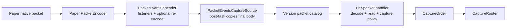
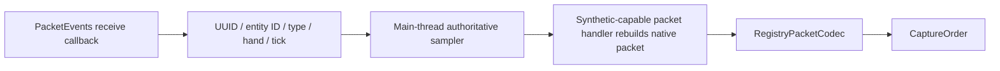
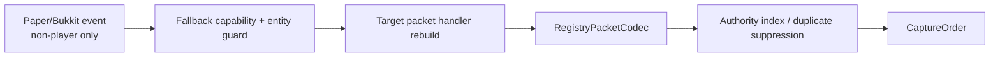
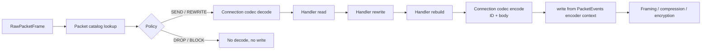

# Plan: paketbezogene Capture- und Rewrite-Architektur

Status: **Architektur freigegeben; konkrete Paketimplementierungen vorläufig entfernt**
Stand: 11. November 2026

> Ergänzung zur Freigabe: Eine Migration bestehender Recordings und ein
> paralleler Erhalt des alten Systems sind ausdrücklich nicht erforderlich.
> Die Umsetzung verwendet deshalb Adapter-Formatrevision 4 und ersetzt den
> bisherigen Rewrite-Pfad direkt.

> Aktueller Implementierungsstand: Das gemeinsame abstrakte Gerüst, die
> Capture-Grenzen und die PacketEvents-Channel-Integration bleiben bestehen.
> Die konkreten Paper-26.2- und Paper-26.3-Paketdefinitionen wurden auf Wunsch
> vollständig entfernt. Beide Versionskataloge sind leer; PLAY-Pakete werden
> weiterhin erfasst, aber bis zu einer expliziten Neuimplementierung als
> `UNSUPPORTED` eingestuft und weder wiedergegeben noch in Checkpoints
> übernommen. Die folgenden Abschnitte beschreiben weiterhin das Zielbild.

> Das verbindliche Klassennamensschema und die vollständige Reihenfolge für
> alle 144/141 PLAY-Pakete sind im ergänzenden Plan
> [`packet-class-naming-and-implementation-order.md`](packet-class-naming-and-implementation-order.md)
> festgelegt.

## 1. Zielbild

Die Erfassung und Wiedergabe von Minecraft-Paketen soll nicht länger durch
wenige große, über String-Switches gekoppelte Klassen gesteuert werden. Für
jeden clientbound PLAY-Pakettyp soll stattdessen eine auffindbare,
versionsgebundene Paketimplementierung die für diesen Typ geltenden Regeln
beschreiben und – soweit erforderlich – dessen Daten lesen, umschreiben und
neu aufbauen.

Eine gemeinsame abstrakte Implementierung steuert den unveränderlichen Ablauf:

1. Descriptor und native Paketklasse validieren;
2. Paket mit dem gebundenen Protokoll-Codec decodieren;
3. typisierte oder semantische Daten auslesen;
4. Capture-, Drop-, Rewrite- oder Fail-Entscheidung treffen;
5. Identitäten und verbindungslokale Felder behandeln;
6. ein natives Paket unverändert weiterverwenden oder neu aufbauen;
7. das Ergebnis wieder mit dem gebundenen Protokoll-Codec encodieren; und
8. es über die richtige Channel-Grenze ausgeben.

Die Zahl der Klassen steigt dadurch bewusst. Im Gegenzug liegen Klassifikation,
Capture-Kontext, Rewrite und paketbezogene Tests nicht mehr in voneinander
getrennten Listen und Switches. Änderungen an einem Paket werden lokal und die
Vollständigkeit wird durch den Katalog geprüft.

## 2. Nicht-Ziele

- Keine Änderung der öffentlichen `replay-api`.
- Keine Änderung am Replay-Dateiformat, an `RawPacketFrame`, Segmenten,
  Checkpoints, Manifesten oder Datenbankverträgen.
- Keine versionsübergreifende Wiedergabe. Paper 26.2 und 26.3 bleiben getrennte
  Adapter mit ihren bestehenden Adapter-IDs.
- Keine neue Benutzeroberfläche oder Route; ein HTML-Mockup ist deshalb nicht
  erforderlich.
- Kein allgemeines Refactoring von Recording, Playback-Scheduler, Storage oder
  Runtime-Komposition außerhalb der für den Paketpfad nötigen Anpassungen.
- Keine automatische Generierung oder Reflection-basierte Discovery von
  Paketimplementierungen zur Laufzeit. Der Katalog soll explizit und prüfbar
  bleiben.

## 3. Ist-Analyse

### 3.1 Bestehende Schichten

Der versionsneutrale Kern ist bereits sinnvoll abgegrenzt:

- `CaptureBridge` übergibt kopierte Paketdaten an den `CaptureRouter`.
- `CaptureRouter` validiert gegen `PacketRegistry` und verteilt nicht blockierend
  an Session-Sinks.
- `RawPacketFrame` speichert Phase, numerische Paket-ID und den unkomprimierten
  Body ohne Transport-Framing.
- `PlaybackBridge` wird pro Viewer geöffnet und hält dessen Isolation.
- `PacketCodec<T>` bildet bereits die richtige adapterinterne Grenze zwischen
  nativem Paket und versionsneutralem Frame.

Diese Verträge müssen nicht aufgebrochen werden. Der Umbau kann weitgehend in
`replay-adapter` bleiben.

### 3.2 Verantwortungsballung

Am Beispiel Paper 26.3:

- `Paper26_3CaptureBridge` umfasst 492 Zeilen und übernimmt PacketEvents-
  Registrierung, Lifecycle, ByteBuf-Kopie, Phasenauflösung, Decode für den
  Capture-Kontext, Duplicate Suppression, synthetische Pakete, Collector-
  Lifecycle, Capture-Reihenfolge und Fehlerweitergabe.
- `PaperConnectionAccessor` umfasst 557 Zeilen und vermischt Channel-Auflösung,
  Pipeline-Mutationen, Decode, Encode, Reflection auf `PacketEncoder`,
  Capture-Kontext und Tick-Zugriff.
- `Paper26_3ReplayPacketRewriter` umfasst 774 Zeilen. Die Identitätsliste,
  verbindungslokale Sonderregeln, Payload-Sonderfälle, ein großer Rewrite-
  Switch, Reflection und sessionlokaler Bossbar-Zustand liegen in einer Klasse.
- `Paper26_3PacketRegistry` führt eine weitere große Klassifikationsliste und
  fragt statische Methoden des Rewriters ab. Registry und Rewrite können daher
  auseinanderlaufen.

Ein konkretes Drift-Symptom ist bereits sichtbar: Der Rewrite-Switch enthält
`set_score` und `reset_score`, während diese Typen nicht in der
`IDENTITY_BEARING`-Menge liegen und laut Registry viewer-lokal sind. Die Zweige
sind damit im normalen Ablauf nicht erreichbar. Das aktuelle Ergebnis ist zwar
durch die Registry sicher, die Wartbarkeit leidet jedoch unter mehreren
Wahrheitsquellen.

### 3.3 Versionsduplizierung

Paper 26.2 und 26.3 besitzen nahezu identische Orchestrierung:

| Komponente | Unterschied laut `git diff --no-index --numstat` |
|---|---:|
| CaptureBridge | 34 Einfügungen / 34 Löschungen |
| ConnectionAccessor | 15 / 8 |
| ReplayPacketRewriter | 17 / 13 |
| PlaybackBridge | 17 / 17 |
| ReplayViewerOutboundGate | 2 / 2 |
| PacketRegistry | 22 / 17 |

Der größte Anteil sind Versionsnamen und wenige Protokolldifferenzen. Die
gemeinsame Ablaufsteuerung sollte daher NMS-frei geteilt werden; native
Paketklassen und deren konkrete Rekonstruktion bleiben im jeweiligen
Versionsmodul.

### 3.4 Paper-/PacketEvents-Channel-Grenze

Die eingebundene PacketEvents-Version 2.14.0 installiert ihren Encoder mit
`addBefore(..., "encoder", ...)` vor dem Paper-`PacketEncoder`. Der aktuelle
Replay-Gate wird dagegen mit `addAfter(Paper PacketEncoder, ...)` hinter dem
Paper-Encoder eingehängt. In Pipeline-Reihenfolge ergibt sich vereinfacht:

```text
head
  -> Transport (Framing / Kompression / Verschlüsselung)
  -> PacketEvents-Encoder
  -> Paper-PacketEncoder
  -> Replay-Live-Gate
  -> tail
```

Outbound läuft in Gegenrichtung:

```text
tail -> Replay-Live-Gate -> Paper-PacketEncoder
     -> PacketEvents-Encoder -> Transport -> head
```

Das aktuelle `ReplayViewerOutboundGate.writeReplay(...)` verwendet den Kontext
des Replay-Gates. Dadurch wird zwar das Gate selbst übersprungen, nicht aber der
Paper- und der PacketEvents-Encoder. Der Kommentar, der Replay-Write überspringe
den späteren Capture-Observer, entspricht daher nicht der tatsächlichen
Pipeline. Läuft gleichzeitig eine Aufnahme, kann ein Replay-Paket erneut als
normales clientbound Paket erfasst werden.

Die neue Architektur muss Live-Pakete und Replay-Pakete explizit an
unterschiedlichen Einstiegspunkten ausgeben:

- Live-Pakete laufen weiterhin durch Gate, Paper-Encoder und PacketEvents.
- Replay-Pakete werden nach dem paketbezogenen Rewrite explizit encodiert und
  vom Kontext des PacketEvents-Encoders aus geschrieben. Ein
  `ChannelHandlerContext.write(...)` beginnt beim vorherigen Handler und
  überspringt somit PacketEvents selbst, den Paper-Encoder und das Replay-Gate;
  die davorliegenden Transportstufen bleiben aktiv.

Der PacketEvents-Kontext darf wegen möglicher Relocation bei Aktivierung der
Kompression nicht dauerhaft gecacht werden. Er wird auf dem Event-Loop vor dem
Write anhand von `PacketEvents.ENCODER_NAME` erneut aufgelöst und seine Position
relativ zum Paper-Encoder geprüft.

### 3.5 Semantik des PacketEvents-Callbacks

PacketEvents liest vor dem Listener-Aufruf die VarInt-Paket-ID aus dem ByteBuf.
Während des Callbacks zeigt der Reader-Index daher auf den Paket-Body. Erst nach
den Listenern wird bei Verwendung eines Wrappers der finale Buffer neu
encodiert. Die aktuelle direkte Kopie bei `MONITOR` sieht deshalb nicht
zwangsläufig die endgültigen Bytes eines durch einen anderen PacketEvents-
Listener veränderten Pakets.

Die Capture-Quelle soll deshalb eine eigene `PacketEventsCaptureSource`
erhalten. Sie registriert weiterhin genau einen `MONITOR`-Listener, hängt die
eigentliche Kopie aber als PacketEvents-Post-Task an. Dieser läuft im
PacketEvents-Encoder nach einer möglichen Wrapper-Neuencodierung und noch vor
dem Weiterreichen an die Transportstufen. Die Implementierung liest die VarInt-
ID aus einer nicht mutierenden Sicht und kopiert nur den Body. Abgebrochene oder
leere Buffer werden nicht publiziert.

PacketEvents-Ereignisse sind dabei **keine Paper/Bukkit-Fallback-Ebene**. Sie
sind die API auf die PacketEvents-Protokollgrenze. Der Begriff Event-Fallback
bezieht sich im weiteren Plan ausschließlich auf Gameplay-/Entity-Events von
Paper oder Bukkit.

### 3.6 Thread-Grenze

Die dokumentierte Policy untersagt Bukkit-/Paper-/NMS-Weltzugriffe im Netty-
Callback. Der aktuelle Capture-Pfad ruft dort jedoch
`PaperConnectionAccessor.connectionFor(player)` auf; diese Methode liest neben
dem Channel auch `player.getWorld()` und `player.getLocation()`.

Der Umbau muss diese Verantwortlichkeiten trennen:

- Ein `PaperChannelHandle` enthält nur UUID und Channel.
- Ein main-thread-gepflegter `ConnectionSceneIndex` hält immutable Snapshots
  der aktuellen Welt einer Verbindung. Die Empfängerposition wird nicht als
  Ersatz für eine Paketposition benutzt.
- Paketposition, Chat-Inhalt und Custom-Payload-Kanal werden ausschließlich aus
  dem bereits decodierten Paket gelesen.
- Serverbound-Callbacks kopieren nur UUID, Entity-ID, Pakettyp, Hand und Tick
  und planen eine autoritative Abfrage auf dem Server-Thread.

Join/Quit/Weltwechsel-Ereignisse dürfen den Connection-Index verwalten. Sie
erzeugen keine Replay-Zustandsänderung und sind daher Lifecycle-Infrastruktur,
nicht Gameplay-Fallback.

### 3.7 Bestehende Event-Fallbacks

Die bestehende Quellenreihenfolge ist fachlich richtig:

1. clientbound Paket;
2. serverbound Signal mit autoritativer Server-Thread-Abfrage;
3. Channel-Grenze für Isolation und Transport;
4. Paper/Bukkit-Event nur als letzter Fallback.

Aktuell verwenden die Adapter `EntityMoveEvent` und
`EntityEquipmentChangedEvent` ausschließlich für Nicht-Spieler. Spieler nutzen
den serverbound-getriggerten Sampler. `EntityRemoveFromWorldEvent` bereinigt nur
Indizes. Diese Regeln sollen erhalten und technisch deutlicher erzwungen werden.

### 3.8 Test-Baseline

Vor der Planung wurden die vorhandenen Adaptertests ausgeführt:

- `:replay-adapter:api:test` ist erfolgreich.
- `:replay-adapter:paper-26_3:test` ist erfolgreich.
- `:replay-adapter:paper-26_2:test` kompiliert aktuell nicht, weil
  `Paper26EntityStateCaptureTest` `InteractionHand` aus PacketEvents direkt
  importiert, PacketEvents aber nur als `compileOnly` vorliegt. Dies ist ein
  bestehender Baseline-Fehler. Für die in diesem Umbau zwingend erforderlichen
  26.2-Tests muss die Test-Classpath-Deklaration gezielt korrigiert werden.

## 4. Architekturentscheidung

### 4.1 Neues NMS-freies Modul `replay-adapter:paper-common`

Empfohlen wird ein neues internes Modul `replay-adapter:paper-common` zwischen
`replay-adapter:api` und den beiden Versionsadaptern.

Es enthält ausschließlich NMS-freie Ablaufsteuerung:

- abstrakte Paketimplementierung und spezialisierte Basisklassen;
- immutable Paketkataloge und Bindung an ein `PacketRegistry`;
- Capture-/Rewrite-/Rebuild-Ergebnisse und Kontexte;
- PacketEvents-Capture-Quelle;
- gemeinsame Netty-Lifecycle- und Pipeline-Hilfen;
- gemeinsame Playback-Queue- und Channel-Boundary-Logik, soweit keine NMS-
  Typen benötigt werden.

Es importiert keine `net.minecraft.*`-Klassen. Dadurch kompiliert es nicht gegen
eine bestimmte Paper-Version und erzwingt keine gemeinsame binäre NMS-Basis für
26.2 und 26.3.

Die vorhandene `replay-adapter:api` bleibt der allgemeine Adaptervertrag. Paper,
PacketEvents und Netty-spezifische Details sollen nicht weiter in diese API
wandern.

### 4.2 Eine Paketimplementierung pro PLAY-Pakettyp

Jedes der 141 PLAY-Pakete in Paper 26.2 und jedes der 144 PLAY-Pakete in Paper
26.3 erhält im jeweiligen Versionsmodul eine benannte Implementierung. Beispiel:

```text
...paper.v26_3.packet.play.AddEntityPacketHandler
...paper.v26_3.packet.play.SetEntityDataPacketHandler
...paper.v26_3.packet.play.SetHealthPacketHandler
...paper.v26_3.packet.play.DisconnectPacketHandler
```

Nicht-PLAY-Pakete bleiben eine einheitliche, aus der Protokoll-Introspektion
erzeugte `CONTROL`-Definition. Sie werden nie in eine bestehende PLAY-Verbindung
injiziert und benötigen keine leeren Klassen. Sollte künftig ein Nicht-PLAY-
Paket fachlich bearbeitet werden, kann es ebenfalls eine konkrete
Implementierung erhalten.

Die hohe Zahl kleiner Klassen ist hier beabsichtigt. Jede Klasse enthält nur
die Abweichung von einer der Basiskategorien:

- `PassThroughPacketHandler`: decodieren, validieren, unverändert neu encodieren;
- `IdentityRewritePacketHandler`: semantisch lesen und mit Session-IDs neu bauen;
- `PayloadSensitivePacketHandler`: anhand des Inhalts senden, anpassen oder
  verwerfen, beispielsweise `game_event` und `explode`;
- `ViewerLocalPacketHandler`: vor dem Decode verwerfen;
- `BlockedPacketHandler`: vor dem Decode als unsicher ablehnen;
- `SyntheticStatePacketHandler`: zusätzlich Aufbau aus autoritativem oder
  Event-Fallback-Zustand erlauben.

### 4.3 Template-Method-Vertrag

Die genaue Java-Signatur wird bei der Implementierung anhand der Typinferenz
festgelegt. Der geplante Vertrag ist konzeptionell:

```java
abstract class AbstractPaperPacket<P, V> {
    PacketSpec spec();
    Class<P> nativeType();

    final PlaybackPacket handlePlayback(
            RawPacketFrame frame,
            PacketCodec<Object> codec,
            PacketRewriteContext context);

    final CapturedPacketData handleCapture(
            CapturedWirePacket packet,
            PacketCodec<Object> codec,
            PacketCaptureContext context);

    protected V read(P packet, PacketReadContext context);
    protected RewriteDecision<V> rewrite(V value, PacketRewriteContext context);
    protected P rebuild(V value, PacketRebuildContext context);
}
```

Die finalen Methoden übernehmen immer:

- Descriptor-, Phase-, Richtung-, ID- und Klassenprüfung;
- Codec-Aufruf und Prüfung auf vollständig konsumierten Body;
- Umsetzung der Policy vor einem unnötigen Decode;
- typisierte Fehler mit Paketname und Adapterversion;
- Encode-Validierung gegen denselben Descriptor; und
- ByteBuf-Lifecycle.

`read`, `rewrite` und `rebuild` sind die paketbezogenen Hooks. Für ein sicheres
Pass-through-Paket sind sie triviale Defaults. Viewer-lokale und blockierte
Pakete werden ohne Decode verworfen; damit bleibt die bestehende
Neutral-Observer-Sicherheitsgrenze erhalten.

Die Handler sind immutable und dürfen keinen Playback- oder Connection-Zustand
halten. `ReplayIdentityMap`, aktive Bossbars und Reset-Beobachtungen liegen in
einem `PacketRewriteContext` pro Playback-Session.

### 4.4 Paketkatalog als einzige Wahrheitsquelle

Pro Version bindet ein expliziter `Paper26xPacketCatalog` die Implementierungen
an den durch `ProtocolIntrospector` gefundenen Registry-Snapshot.

Der Katalog liefert:

- `PacketDescriptor` und damit weiterhin den bestehenden Registry-Fingerprint;
- Lookup nach Phase/Richtung/ID für Capture und Playback;
- Lookup nach stabilem Pakettyp für native Paper-Pakete;
- die passende Paketimplementierung; und
- deklarierte Capture-Quellen und Fallback-Grenzen.

Beim Start wird geprüft:

1. Jeder live gefundene PLAY-Typ besitzt genau eine Implementierung.
2. Keine Implementierung referenziert einen nicht vorhandenen Typ.
3. Native Klasse, stabile Typ-ID und Codec-Key passen zusammen.
4. `VIEWER_LOCAL` wird nicht gleichzeitig als Identity-Rewrite deklariert.
5. `CONTROL` und `UNSUPPORTED` sind weder replaybar noch checkpoint-relevant.
6. Jeder checkpoint-relevante Descriptor besitzt weiterhin einen sicheren
   Checkpoint-Generator.
7. Der erzeugte Fingerprint entspricht dem bestehenden Golden Value.

Unbekannte PLAY-Pakete führen beim Öffnen des Adapters zu einer klaren
`IncompatibleAdapterException`; sie werden nicht implizit mit einer unsicheren
Default-Policy produktiv geschaltet. Für die fest gebundenen Paper-Builds ist
das die sicherere Variante.

### 4.5 Codec-Aufteilung

Die Paketimplementierung steuert den Ablauf, implementiert aber nicht erneut
das Minecraft-Wireformat. Verwendet werden weiterhin die nativen, an den
jeweiligen ProtocolInfo-/Registry-Kontext gebundenen Stream-Codecs.

Geplant sind zwei Codec-Sessions hinter demselben internen Vertrag:

- `ConnectionPacketCodec`: Decode und Encode gegen den live gebundenen
  Connection-Codec auf dem Channel-Event-Loop;
- `RegistryPacketCodec`: Encode für Checkpoints und synthetische Pakete gegen
  den serverweit gebundenen PLAY-Codec, weiterhin mit kontrollierter
  Serialisierung.

Damit werden die derzeit getrennten Encode-Implementierungen in
`PaperConnectionAccessor` und `Paper26xNativePacketCodec` auf dieselben
Validierungs- und VarInt-Hilfen zurückgeführt. Checkpoint-Snapshot-Erzeugung und
deren Familienlogik bleiben unverändert; sie verwenden nur denselben
paketbezogenen Encode-Pfad.

## 5. Geplanter Datenfluss

### 5.1 Clientbound Capture



An abgebrochenes Paket erreicht den Capture-Pfad nicht. Der ByteBuf wird nicht
gespeichert oder retained; ID und Body werden innerhalb des PacketEvents-
Handlers defensiv kopiert. Der Handler liest nur Paketsemanik und immutable
Connection-Snapshots.

### 5.2 Serverbound getriggerter Zustand



Der Receive-Callback liest keine Welt, Entity, Location, Inventory- oder NMS-
Zustände. Mehrere Signale eines Spielers werden weiterhin zusammengeführt.

### 5.3 Paper/Bukkit-Fallback



Ein neuer Fallback muss im Zielhandler mit Grund und Reichweite deklariert
werden. Ohne diese Capability darf die Event-Quelle kein Paket publizieren.

### 5.4 Playback und Channel-Bypass



Das Replay-Paket wird nicht erneut von PacketEvents beobachtet und kann nicht
in eine gleichzeitig aktive Aufnahme zurücklaufen. Ein Channel-Write-Fehler
scheitert nur die betroffene Playback-Session; Live-Traffic wird weiterhin
genau einmal weitergeleitet.

## 6. Paper-/PacketEvents-Handler im Detail

### 6.1 Live-Gate

Der bestehende `ReplayViewerOutboundGate` wird zu einem gemeinsamen,
NMS-freien `PaperLiveOutboundGate` reduziert.

- Position weiterhin direkt hinter dem Paper-Encoder, damit es native
  Paper-Pakete vor deren Encode klassifizieren kann.
- Klassifikation über den Paketkatalog statt über ein zusätzliches Encode nur
  zur Ermittlung der numerischen ID.
- Viewer-lokale und Control-Pakete passieren unverändert.
- Replayfähiger Live-Szenenzustand wird nach Aktivierung der Isolation
  unterdrückt.
- Bei Klassifikationsfehlern wird die Playback-Session beendet, das ursprüngliche
  Live-Paket aber genau einmal weitergeleitet.

### 6.2 Replay-Wire-Writer

Ein eigener `PacketEventsReplayWriter` übernimmt Replay-Ausgaben:

- nur auf dem Channel-Event-Loop;
- löst `PacketEvents.ENCODER_NAME` für jeden Drain-Turn neu auf;
- prüft die relative Position zu Paper-Encoder und Gate;
- baut aus Paket-ID und Body einen neuen, channel-allokierten ByteBuf;
- schreibt vom PacketEvents-Kontext aus, sodass PE/Paper/Gate übersprungen
  werden, Transporthandler aber erhalten bleiben;
- flush erfolgt an derselben Grenze;
- klare Ownership-Regel: nach erfolgreichem `write` besitzt die Pipeline den
  Buffer, bei synchronem Fehler wird er freigegeben.

### 6.3 Installation und Entfernung

- Alle Pipeline-Mutationen laufen auf dem Channel-Event-Loop.
- Handlernamen sind reserviert und pro Channel eindeutig.
- Installation validiert Paper- und PacketEvents-Handler, bevor Isolation aktiv
  werden kann.
- Die sichere Teleport-/Vorbereitungsphase bleibt vor `activateIsolation()`.
- Close entfernt den Gate-Handler, wartet wie bisher vor Wiederherstellung des
  Live-Zustands und verwirft wartende Replay-Writes kontrolliert.
- Disconnect, bereits entfernter Handler und geschlossener Event-Loop bleiben
  idempotente Shutdown-Pfade.

## 7. Fallback-Regeln

### 7.1 Beizubehaltende Fallbacks

- `EntityMoveEvent`: nur Nicht-Spieler, da keine owner connection und kein
  serverbound Spielerstream existiert.
- `EntityEquipmentChangedEvent`: nur Nicht-Spieler, aus demselben Grund.
- `EntityRemoveFromWorldEvent`: ausschließlich Index-/Snapshot-Bereinigung,
  keine Präsentationsquelle.

### 7.2 Verbotene Event-Primärquellen

Solange der serverbound Paketstream verfügbar ist, bleiben für Spieler verboten:

- `PlayerMoveEvent` als Bewegungsquelle;
- Inventory-/Equipment-Events als Ausrüstungsquelle;
- Arm-Swing-Events als Animationsquelle.

### 7.3 Technische Erzwingung

Eine interne `CaptureSource`-Kennzeichnung begleitet synthetische Kandidaten bis
zum Paketkatalog:

```text
CLIENTBOUND_PACKET
SERVERBOUND_AUTHORITATIVE_SAMPLE
PAPER_EVENT_FALLBACK
CHECKPOINT_SNAPSHOT
```

Der jeweilige Handler erlaubt nur die für ihn vorgesehenen Quellen. Für einen
Event-Fallback enthält die Deklaration zusätzlich `NON_PLAYER_ONLY` und eine
kurze Begründung. Diese Information ist intern und wird nicht in
`RawPacketFrame` persistiert.

Duplicate Suppression wird aus dem globalen String-/Byte-Parser in die
betroffenen Bewegung-, Equipment-, Entity-Event- und Swing-Handler verschoben.
Entity-IDs werden dort aus dem verifizierten nativen Paket gelesen; beliebige
Integer-Felder werden weiterhin nicht geraten.

## 8. Betroffene Komponenten

### 8.1 Neue Komponenten

| Bereich | Geplante Komponente | Aufgabe |
|---|---|---|
| Build | `replay-adapter:paper-common` | NMS-freie gemeinsame Paper-/PacketEvents-Abläufe |
| Packet | `AbstractPaperPacket<P,V>` | Template für Decode, Read, Rewrite, Rebuild, Encode |
| Packet | Policy-Basisklassen | Pass-through, identity rewrite, payload-sensitive, local, blocked, synthetic |
| Registry | `PaperPacketCatalog` | eindeutiger Lookup und Bindung an Live-Registry |
| Capture | `PacketEventsCaptureSource` | finale clientbound Body-Kopie und serverbound Signale |
| Capture | `ConnectionSceneIndex` | main-thread-gepflegte immutable Weltzuordnung |
| Channel | `PaperLiveOutboundGate` | Unterdrückung konkurrierender Live-Szenenpakete |
| Channel | `PacketEventsReplayWriter` | encodierter Replay-Bypass ohne Recapture |
| Context | `PacketRewriteContext` | sessionlokale IDs, Bossbars und Reset-Beobachtung |
| Versionen | `...packet.play.*PacketHandler` | Verhalten pro Paper-Version und PLAY-Paket |

### 8.2 Zu ersetzende oder aufzuteilende Komponenten

- `Paper26CaptureBridge` / `Paper26_3CaptureBridge` werden schmale
  versionsgebundene Kompositionsklassen.
- Beide `PaperConnectionAccessor` werden in Channel-Zugriff, Pipeline-Grenze,
  Codec und Capture-Kontext getrennt.
- `Paper26ReplayPacketRewriter` / `Paper26_3ReplayPacketRewriter` entfallen nach
  vollständiger Paketmigration.
- Die großen Klassifikationsmaps in `Paper26PacketRegistry` und
  `Paper26_3PacketRegistry` werden durch Katalogmetadaten ersetzt.
- Beide `ReplayViewerOutboundGate`-Kopien werden durch die gemeinsame Gate-
  Implementierung ersetzt.
- `Paper26xEntityPacketFactory` wird auf die paketbezogenen Rebuild-Hooks
  verteilt oder nur noch als sehr kleine native Konstruktionshilfe verwendet,
  wenn mehrere Quellen exakt denselben Aufbau benötigen.

### 8.3 Unveränderte Komponenten

- `replay-api` und seine öffentlichen Services;
- `replay-core`-Routing, Queueing, Scheduler und Timeline;
- `replay-format` und alle persistierten Strukturen;
- Storage- und Datenbankmodule;
- Snapshot-Ermittlung und Checkpoint-Familien, abgesehen vom gemeinsamen
  validierten Encode-Einstieg.

## 9. Migrationsplan nach Freigabe

### Phase 0: Git- und Baseline-Vorbereitung

1. Lokalen Hauptbranch gegen `origin/master` prüfen und ohne Verlust lokaler
   Änderungen synchronisieren.
2. Separaten Branch `codex/refactor-packet-capture-rewrite` vom aktuellen
   Hauptbranch erstellen.
3. Vorhandene unversionierte `.idea/`-Dateien nicht übernehmen.
4. Den bestehenden 26.2-Test-Classpath minimal um PacketEvents für Tests
   ergänzen und die unveränderte Baseline erneut ausführen.

### Phase 1: Gemeinsame Verträge und Katalog

1. `paper-common` anlegen und nur notwendige Abhängigkeiten deklarieren.
2. Paket-Spec, Ergebnisse, Kontexte und abstrakte Basisklassen implementieren.
3. Immutable Katalogbindung mit O(1)-Lookup nach Paket-Key und Typname bauen.
4. Contract-Tests für Lifecycle, Vorab-Drop, Typprüfung, Encode-/Decode-
   Validierung und Katalogduplikate ergänzen.

### Phase 2: Vertikaler 26.3-Pilot

1. Paper 26.3 zuerst migrieren, weil dort mit `swing_animation`,
   `add_transient_block` und `post_effects` die größere Protokolloberfläche
   liegt.
2. Zunächst Kategorien `BLOCKED`, `VIEWER_LOCAL` und `PASS_THROUGH` anlegen.
3. Danach Identity-Rewrite-Pakete einzeln aus dem großen Switch herauslösen.
4. Payload-Sonderfälle und sessionlokale Zustände zuletzt migrieren.
5. Für jede migrierte Implementierung Alt-/Neu-Parität mit bestehenden
   Fixtures prüfen; erst danach den zugehörigen Switch-Zweig entfernen.
6. Bestehenden 26.3-Registry-Fingerprint unverändert halten.

### Phase 3: Channel-Grenze korrigieren

1. Gemeinsames Live-Gate einsetzen.
2. Replay-Ergebnis nach Rewrite explizit encodieren.
3. `PacketEventsReplayWriter` mit dynamischer Context-Auflösung einsetzen.
4. Replay-Recapture ausschließen und Pipeline-Reihenfolge fail-fast prüfen.
5. Queue-, Flush-, Seek-Abbruch- und Close-Semantik beibehalten.

### Phase 4: Capture-Quelle und Thread-Grenze

1. `PacketEventsCaptureSource` aus der CaptureBridge herauslösen.
2. Finale Body-Kopie im PacketEvents-Post-Task implementieren.
3. `ConnectionSceneIndex` auf dem Server-Thread pflegen.
4. Capture-Kontext paketbezogen auslesen; keine Bukkit-Welt-/Location-Abfrage
   im Netty-Callback.
5. Capture-Order und Checkpoint-Barriere unverändert weiterverwenden.

### Phase 5: Autoritative Quellen und Event-Fallbacks

1. Player-Sampler auf paketbezogene Synthetic-Rebuild-Hooks umstellen.
2. Non-player Movement/Equipment-Fallbacks mit Source-Capability anbinden.
3. Duplicate Suppression in die betroffenen Handler verschieben.
4. Cleanup-Event klar von Zustandsquellen trennen.

### Phase 6: Paper 26.2 portieren

1. Den bewährten gemeinsamen Ablauf übernehmen.
2. Nur echte 26.2-NMS-Unterschiede in den konkreten Handlern implementieren.
3. Alle 141 PLAY-Pakete vollständig binden.
4. Bestehenden 26.2-Registry-Fingerprint unverändert halten.

### Phase 7: Altcode entfernen und dokumentieren

1. Monolithische Rewriter, doppelte Gate-Logik und nicht mehr benötigte Codec-
   Hilfen entfernen.
2. Adapterreferenzen für 26.2/26.3 und `capture-source-policy.md` aktualisieren.
3. Architekturdiagramm um Katalog und Channel-Bypass ergänzen.
4. Prüfen, dass keine öffentlichen oder persistierten Verträge unbeabsichtigt
   verändert wurden.

## 10. Test- und Validierungsplan

### 10.1 Gemeinsame Contract-Tests

- Drop/Block erfolgt vor Decode.
- Descriptor, native Klasse, ID, Phase und Richtung werden geprüft.
- Decode konsumiert den Body vollständig.
- Rebuild/Encode ergibt wieder denselben gebundenen Descriptor.
- Handler sind zustandslos; zwei Playback-Kontexte isolieren IDs und Bossbars.
- Katalog lehnt Duplikate, Lücken und widersprüchliche Policies ab.

### 10.2 Pro Paket

- Für jede konkrete PLAY-Implementierung existiert mindestens ein
  Klassifikations-/Katalogtest.
- Identity- und Payload-Sonderfälle behalten fokussierte native Tests.
- Rewrite-Tests aus `NeutralObserverTest` werden den jeweiligen Handlern
  zugeordnet, nicht durch einen einzigen breiten Switch-Test ersetzt.
- Codec-Roundtrip wird für repräsentative Pakete jeder Kategorie getestet.

### 10.3 Channel-/PacketEvents-Tests

Mit `EmbeddedChannel` beziehungsweise einer kleinen Testpipeline werden geprüft:

1. Live-Szenenpaket wird bei inaktiver Isolation weitergeleitet.
2. Live-Szenenpaket wird bei aktiver Isolation unterdrückt.
3. Viewer-lokales/Control-Live-Paket passiert immer.
4. Replay-Paket läuft durch Transport, aber weder durch Gate noch durch den
   PacketEvents-Capture-Listener.
5. Gleichzeitige Aufnahme erhält kein Replay-Echo.
6. PacketEvents-Wrapper-Reencode wird in finaler Form erfasst.
7. Cancellation erzeugt kein Capture.
8. Reader-Index und Reference Count des fremden ByteBuf bleiben korrekt.
9. PacketEvents-Handler-Relocation beziehungsweise erneute Context-Auflösung
   wird abgedeckt.
10. Fehlender oder falsch positionierter PacketEvents-/Paper-Encoder scheitert
    Playback kontrolliert, ohne Live-Traffic doppelt zu schreiben.

### 10.4 Capture-/Fallback-Tests

- Kein Bukkit-/Paper-Weltzugriff aus einem simulierten Event-Loop-Callback.
- Serverbound-Signale werden zusammengeführt und auf dem Main Thread gelesen.
- Player werden von beiden Gameplay-Event-Fallbacks strikt abgewiesen.
- Nicht-Spieler-Bewegung und -Equipment erzeugen die gleiche native
  Paketrepräsentation wie andere Quellen.
- Hand-Swap- und Swing-Suppression bleiben paket- und tickgenau.
- Entity-Removal bereinigt Indizes, erzeugt aber kein Präsentationspaket.

### 10.5 Kompatibilitäts- und Gesamttests

- Golden Fingerprints:
  - Paper 26.2:
    `d9d610afb1ff45fa2a97302337053d3f9643e6d09a685cf32652bc6678ffd744`
  - Paper 26.3:
    `dfb7e34c58fb9b0748f0d045c79d76c5706ff33fc1f4cbeded686642de6eb8ea`
- Bestehende Checkpoint-Fixtures bleiben byte-/semantikkompatibel.
- Revision-3-Artefakte werden bewusst nicht migriert; Revision 4 ist die neue
  harte Adaptergrenze.
- Zielgerichtet:

  ```text
  gradlew :replay-adapter:api:test
          :replay-adapter:paper-common:test
          :replay-adapter:paper-26_2:test
          :replay-adapter:paper-26_3:test
  ```

- Abschließend vollständiges `gradlew test`.
- Manueller Paper-Test je unterstützter Version mit gleichzeitig aktiver
  Aufnahme und Wiedergabe, einschließlich Seek, Disconnect und Shutdown.

## 11. Performance- und Sicherheitsvorgaben

- Katalog-Lookup O(1), keine lineare Suche über Paketklassen im Hot Path.
- Paketimplementierungen werden einmal erstellt und sind immutable.
- Pro Capture/Playback wird höchstens einmal decodiert und einmal encodiert.
- Viewer-lokale und blockierte Pakete werden ohne Decode verworfen.
- Keine Reflection-basierte Handler-Discovery im Hot Path.
- Unvermeidbare NMS-Feldzugriffe werden pro Version beim Start validiert und
  in der konkreten Paketklasse gekapselt.
- Netty-Callbacks führen nur begrenzte Speicherarbeit aus und blockieren nie
  auf Server-Thread, Writer oder Storage.
- ByteBuf-Ownership und Promise-Fehler sind für jeden Channel-Write explizit.
- Ein Fehler in einer Playback-Session darf Live-Pakete nicht verlieren; ein
  Capture-Integritätsfehler muss aktive Recordings weiterhin fehlschlagen
  lassen.

## 12. Risiken und Gegenmaßnahmen

| Risiko | Gegenmaßnahme |
|---|---|
| Viele Klassen werden unvollständig registriert | expliziter Katalog plus Live-Registry-Vollständigkeitstest |
| 26.2/26.3 driften erneut | NMS-freie Orchestrierung im gemeinsamen Modul; versionsspezifisch nur Paketdetails |
| Registry-Fingerprint ändert sich unbemerkt | Golden-Fingerprint-Test; Änderung gilt als Fehler, solange nicht separat genehmigt |
| Replay wird erneut erfasst | encodierter Write ab PacketEvents-Kontext plus Echo-Integrationstest |
| PacketEvents verschiebt Handler bei Kompression | Kontext dynamisch auflösen und Reihenfolge vor jedem Drain-Turn validieren |
| Wrapper eines anderen Plugins ändert Pakete | Capture erst im PacketEvents-Post-Task nach Reencode |
| Bukkit-Zugriff vom Netty-Thread | main-thread-gepflegter immutable Connection-Index |
| Event-Fallback wird zur Primärquelle | Source-Capability, Player-Guard und verpflichtende Fallback-Begründung |
| Sessionzustand gelangt in Singleton-Handler | ausschließlich `PacketRewriteContext` pro Playback-Session |
| Migration wird zu einem Big Bang | 26.3-Vertikalschnitt, Alt-/Neu-Parität pro Paket, danach 26.2 |

## 13. Geplante Commit-Struktur

Nach Freigabe sollen kleine, logisch getrennte Commits entstehen, zum Beispiel:

1. `test: restore paper 26.2 adapter test classpath`
2. `refactor: add shared paper packet contracts`
3. `refactor: migrate paper 26.3 packet catalog`
4. `fix: isolate replay writes from packet capture`
5. `refactor: separate packet capture sources`
6. `refactor: constrain paper event fallbacks`
7. `refactor: migrate paper 26.2 packet catalog`
8. `docs: document packet capture and rewrite pipeline`

Die endgültige Aufteilung richtet sich nach tatsächlich unabhängig prüfbaren
Zwischenständen. Es werden ausschließlich aufgabenbezogene Dateien gestaged.

## 14. Abnahmekriterien

Der Umbau ist abgeschlossen, wenn alle folgenden Punkte erfüllt sind:

- Jeder PLAY-Pakettyp beider unterstützter Versionen besitzt genau eine
  konkrete Paketimplementierung.
- Registry-Klassifikation und Rewrite-Verhalten stammen aus demselben Katalog.
- Die monolithischen Rewrite-Switches sind entfernt.
- Decode, Read, Rewrite, Rebuild und Encode folgen dem gemeinsamen Template.
- Replay-Ausgaben werden nicht erneut von PacketEvents erfasst.
- Live-Pakete behalten bei Fehlern Exactly-once-Weiterleitung.
- Kein Capture-Callback liest mutable Bukkit-/Paper-Weltzustände.
- Paper/Bukkit-Events sind nur dokumentierte Nicht-Spieler-Fallbacks oder reine
  Lifecycle-/Cleanup-Signale.
- Beide bestehenden Registry-Fingerprints bleiben unverändert.
- Bestehende Replay-Artefakte und Checkpoint-Fixtures bleiben kompatibel.
- Alle zielgerichteten und vollständigen Tests laufen erfolgreich.
- Dokumentation beschreibt die tatsächliche Pipeline und Quellenhierarchie.

## 15. Freigabepunkt

Bis zu einer ausdrücklichen Genehmigung dieses Plans werden keine
Implementierung, kein Implementierungsbranch, keine Synchronisierung mit dem
Remote und keine produktiven Codeänderungen vorgenommen. Änderungswünsche am
Entwurf können direkt in diesen Plan eingearbeitet werden.
