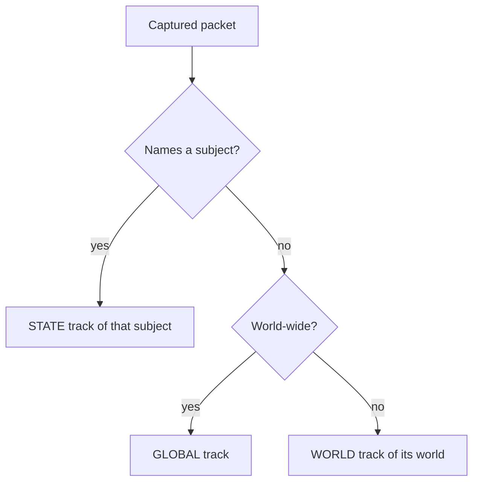

# Recording tracks

A recording is a set of **tracks**, the way a media container holds video,
audio and subtitle tracks. Each track is a time-ordered stream of packet
frames with its own segments, index and checkpoints. What belongs to a whole
stream, such as its world, is stored once on the track instead of on every
frame.

Tracks keep different kinds of data apart. Playback reads the scene the
viewer watches and nothing else; the inventory of a player or the scene of
another world is read only when someone asks for it.

## Track kinds

| Kind | Key | Contents | Read during playback |
|---|---|---|---|
| `GLOBAL` | none | world-wide packets: chat, tab list, player profiles | always |
| `WORLD` | world key | the scene of one world: chunks, blocks, entities, effects, time, weather, border | the viewed world always; other worlds when players there are queried |
| `STATE` | subject | the state of one subject that the scene does not show | when the subject's state is queried |

A recording has exactly one `GLOBAL` track, one `WORLD` track per recorded
world and one `STATE` track per recorded subject. A track is created when
its first packet arrives.

For example, a four-minute recording of two players who travelled from the
overworld into the nether, while a few chest minecarts and donkeys were in
view, consists of these tracks:

| ID | Kind | Key | Segments | Size |
|---:|---|---|---:|---:|
| 0 | `GLOBAL` | | 8 | 32 KB |
| 1 | `WORLD` | `minecraft:overworld` | 8 | 28.5 MB |
| 2, 3 | `STATE` | the two players | 3 and 8 | 3 KB and 9 KB |
| 4 to 7, 10 | `STATE` | five chest minecarts | 1 each | under 1 KB each |
| 8, 9 | `STATE` | two donkeys with chests | 1 and 2 | under 1 KB each |
| 11 | `WORLD` | `minecraft:the_nether` | 7 | 11.9 MB |

Nearly all of the data is scene. A viewer in the nether reads tracks 0 and
11; the overworld's 28.5 MB stay untouched until the viewer switches to it.

## Routing

The core routes every captured packet to exactly one track:



- A packet names a subject when its definition declares it as the
  recipient's own state (`RecipientState`), or when Argus sampled it for an
  entity.
- A packet is world-wide when its definition says so: public chat, system
  broadcasts and the tab list.
- Every other packet belongs to the world it was observed in.

Each track has its own segment writer and rotates its segments
independently under the recording's `ReplayBudget`.

## Subjects

A subject is anything with state of its own. It is identified by kind and
UUID; the label in the manifest is for display only.

| Subject kind | Identity | State recorded in 26.2 |
|---|---|---|
| `PLAYER` | profile UUID | inventory with armor and off hand, hotbar and selected slot, health, food and saturation, experience |
| `ENTITY` | entity UUID | the inventory of villagers, wandering traders, piglins and allays; the content of chest and hopper minecarts and chest boats; the chest of donkeys, mules and llamas |

The scene already shows what every client sees of an entity: equipment,
health where the client gets it, effects, flags and type-specific metadata.
A `STATE` track holds only what no client sees without opening the subject
or being it.

Not recorded: the item a player holds on its cursor, its abilities, the
containers it opens, and the contents of block entities such as chests.

### State sources

A state track is filled by one of two sources. Both produce the native
packets the server sends a client that views the subject, so a state track
is packet-based like every other track.

- **Observed.** A player's own connection receives its state. In 26.2 the
  player's own `container_set_content` and `container_set_slot` for window
  0, `set_player_inventory`, `set_held_slot`, `set_health` and
  `set_experience` describe their recipient and go to its state track.
- **Sampled.** Nobody receives an entity's inventory unless they open it.
  `Paper26_2SubjectStates` reads it on the server thread every
  `ObserverOptions.stateSampleInterval` and emits the packets when the
  state's signature changed.

When a subject comes into a watch's coverage, its complete state is
published. A subject that leaves the coverage keeps its track, which
receives empty checkpoints until the subject returns.

## Checkpoints across tracks

At every checkpoint barrier, every track writes a checkpoint: the packets a
client needs to start that track at that moment.

| Track | Checkpoint contents |
|---|---|
| `WORLD` | the scene of that world within the watch's coverage |
| `GLOBAL` | the tab list |
| `STATE` | the complete state of its subject, built like the packets a client receives on join or when opening the subject |

All tracks share the barrier's ordinal and time. A track created later
writes empty checkpoints for the barriers before it, so every track has one
checkpoint per barrier and every index starts at ordinal 0. The figure under
[playback](#playback) shows a nether track with empty checkpoints before its
first packet.

Playback answers barrier *n* with checkpoint *n* of every track it reads.
The global track always exists as track 0, and playback seeks on its index.

A barrier is allocated on the server thread through the same ordering as
captured packets. Every packet ordered before the barrier belongs to the
time before the checkpoint, every later packet to the frames after it, so a
checkpoint and its following frames never overlap.

## Frame format

Frames are written in format revision 5:

| Field | Encoding |
|---|---|
| record length | VarInt |
| time | unsigned VarLong, nanoseconds since the previous frame of the segment or checkpoint |
| server tick | zigzag VarLong, ticks since the previous frame |
| sequence within the tick | VarInt |
| packet ID | VarInt |
| payload | the packet body |

Phase and world are properties of the track; every frame is a PLAY frame.
The first frame of a segment or checkpoint is relative to its start. A
frame header takes 6 to 10 bytes, and segments are compressed on top of
that.

The sequence is unique within a server tick across all tracks, so frames of
several tracks merge into one exact order by time, tick and sequence.

## Files

```text
manifest.json
tracks/<track-id>/index.bin
tracks/<track-id>/segments/<n>.segment
tracks/<track-id>/checkpoints/<n>.checkpoint
```

Segments and checkpoints are numbered with eight digits, for example
`tracks/11/segments/00000003.segment`.

The manifest names the adapter and registry the recording depends on, lists
the tracks, and lists every file with its type, size and SHA-256 digest:

```json
{
  "replayId": "0219de34-7e9f-47df-84e7-b85035cb7f43",
  "adapterId": "paper-26.2",
  "protocolVersion": 776,
  "registryFingerprint": "d0fc878c...",
  "formatRevision": 5,
  "durationNanos": 235472855100,
  "tracks": [
    { "id": 0, "kind": "GLOBAL" },
    { "id": 1, "kind": "WORLD", "world": "minecraft:overworld", "label": "minecraft:overworld" },
    { "id": 8, "kind": "STATE", "subjectKind": "ENTITY",
      "subjectId": "f5b00f08-9d7b-4a1e-bece-bf486047152f", "label": "minecraft:donkey" }
  ],
  "files": [
    { "type": "CHECKPOINT", "path": "tracks/0/checkpoints/00000000.checkpoint",
      "sizeBytes": 3618, "sha256": "e748627d..." }
  ]
}
```

Track IDs are small integers assigned in order of creation. Recordings of
earlier format revisions are not read.

## Playback


- **Opening.** Playback reads the index of every track. Segments are read
  only when their frames are requested, through the shared segment cache.
- **Timeline.** `MergedTrackData` merges the global track and the viewed
  world's track into one stream. A seek starts at the global track's floor
  checkpoint and the checkpoint of the same ordinal in the world track.
- **World switch.** `PlaybackSession.viewWorld(...)` replaces the world
  track of the timeline and rebuilds the scene at the current position,
  like a seek.
- **Other worlds.** `PlaybackSession.recordedPlayers()` reads, for every
  world the viewer does not watch, that world's checkpoint at the floor
  barrier and its frames up to the current position. The adapter scans them
  for players and their positions (`PlaybackBridge.players(frames)`).
- **State.** `PlaybackSession.state(subject)` opens the subject's track on
  first use, reads its checkpoint at the floor barrier and its frames up to
  the current position, and lets the adapter decode them
  (`PlaybackBridge.decodeState`).

Queries that may read a track outside the timeline return a
`CompletionStage`.

## API

### State of a player or an entity

```java
RecordedSubject subject = RecordedSubject.player(playerId);

session.state(subject).thenAccept(state -> state.ifPresent(found -> {
    ItemStack helmet = found.equipment().get(EquipmentSlot.HEAD);
    found.section(SubjectState.HOTBAR).ifPresent(hotbar ->
            hotbar.selected().ifPresent(slot -> { /* held slot 0-8 */ }));
    found.vitals().ifPresent(vitals -> { /* health, food, saturation */ });
    found.experience().ifPresent(xp -> { /* level, progress, total */ });
}));
```

`SubjectState` holds the equipment by `EquipmentSlot` and a list of item
sections named by keys. Which sections exist depends on the subject:

| Section | Subjects | Contents |
|---|---|---|
| `SubjectState.HOTBAR` | players | nine slots; `selected()` is the held slot |
| `SubjectState.INVENTORY` | players, villagers, piglins, allays | the main inventory or the items a mob carries |
| `SubjectState.CONTAINER` | minecarts, chest boats, chested animals | the container's content |

Vitals and experience exist for players. The result is empty when the
subject is not part of the recording at the current position.

### Entities of the scene

```java
for (RecordedEntity entity : session.entities()) {
    entity.location();          // world, x, y, z, yaw, pitch
    entity.health();            // when the scene shows it
    entity.flags();             // ON_FIRE, SNEAKING, GLIDING, ...
    entity.subject().ifPresent(subject -> session.state(subject));
}
```

`entities()` lists every entity of the viewed world at the current
position; `entity(int)` resolves an entity ID the viewer's client knows.
Both are answered from the scene packets already played and need no I/O.
`subject()` is present when the entity has a state track.

### Interactions

When a viewer right-clicks or attacks a replay entity, the 26.2 bridge
reads the viewer's serverbound `interact` or `attack` packet before the
server's packet handler, consumes it, and publishes an event:

```java
framework.events().subscribe(event -> {
    if (event instanceof ReplayEventPublisher.PlaybackEntityInteracted clicked && !clicked.attack()) {
        // clicked.entity() is what the scene shows; schedule Bukkit work on the server thread
    }
});
```

Packets aimed at live entities pass unchanged. The example plugin opens an
inventory view of the clicked subject this way.
