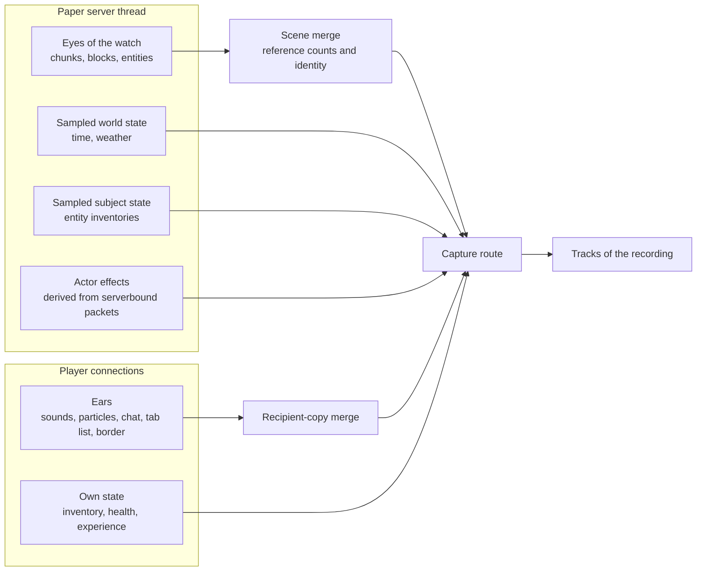

# Argus: virtual observers

Argus is the observer system that supplies every recording with its scene.
Instead of recording whatever happens to reach connected players, a
recording owns its own packet recipients, **eyes**, which the server treats
like players for chunk and entity delivery but which no player, plugin or
player count can see.

This document describes how eyes work, where they are placed, how the
packets of several eyes become one scene, and which packets come from other
sources. The resulting stream is stored in [tracks](recording-tracks.md).

## Terms

| Term | Meaning |
|---|---|
| eye | one virtual observer: a packet recipient that belongs to a recording |
| fixed eye | an eye at a planned position that covers part of a region |
| companion | an eye that follows one player through a world |
| watch | the set of eyes of one recording, opened and closed with it |
| scene | what the eyes of one watch see in one world, without duplicates |
| ear | a real player connection that contributes packets eyes never receive |
| coverage | the area a watch currently sees, used for checkpoints |

## Why the scene does not come from players

A recording built from the packets of connected players has gaps that no
packet definition can close:

- a player never receives its own entity, so its movement, equipment and
  animations would have to be reconstructed;
- the server tears down and rebuilds the view of a dying or respawning
  player;
- nothing is recorded while no player is online or near; and
- every packet arrives once per recipient and must be deduplicated by
  content.

An eye sees every player the way another player would, its view is never
torn down, and it exists whether anyone is online or not.

## Sources of a recording



Each source covers what the others cannot. The capture route tags every
packet with its `CaptureOrigin` and accepts each kind of packet from exactly
one source, so no scene change is recorded twice.

| Source | Origin | Delivers |
|---|---|---|
| eyes | `OBSERVER` | everything the chunk system and the entity tracker send: chunks, light, blocks, block entities, entity spawn, movement, metadata, equipment, attributes, effects, removal |
| sampled world state | `OBSERVER` | time and weather |
| sampled subject state | `OBSERVER` | the inventories of players every tick, of entities and of container blocks, see [subject state](#subject-state) |
| ears | `PLAYER_ONLY` | packets the server sends to listed players only: sounds, particles, level events, explosions, boss bars, world border, chat, player profiles, the tab list |
| own state | `PLAYER_ONLY` | the recipient's own health and experience, kept in its state track |
| actor effects | `PLAYER_ONLY` | effects the server sends to everyone except the acting player, derived where no other player received them |

A player connection publishes only packets no eye can receive. Scene packets
it receives, and packets that describe one player's own view, such as its
chunk cache center or a position correction, are dropped in the capture
bridge, because every scope is observed by Argus.

## The eye

A version adapter's `ArgusEye` creates a `ServerPlayer` that is never added to its
level and never added to the player list. It is registered with exactly two
server systems:

| System | Registration | What it delivers |
|---|---|---|
| Moonrise chunk loader | `RegionizedPlayerChunkLoader.addPlayer` | chunks, light, block and block-entity changes, view center and radius |
| Nearby-player map | `NearbyPlayers.addPlayer` | everything the entity tracker sends: spawn, pairing data, movement, metadata, equipment, attributes, effects, removal |

Its connection has no socket. `Connection.send` hands each packet object to
Argus on the server thread, in server order, before any encoding.

A level only ticks the chunk loaders of listed players and pauses entity
ticking after 300 ticks without them. Argus therefore drives the loader of
every eye itself and resets the level's empty timer once per tick.

### Imperceptibility

No client is ever told about an eye. It is not an entity, so the tracker
never sends it, and it is not in the player list, so there is no tab entry,
join message, player count, `/list` entry or `@a` match. It has no hitbox and
cannot be targeted, damaged, pushed, ridden or selected with `@e`.
`Bukkit.getOnlinePlayers()`, `World.getPlayers()` and the level's player
list stay unchanged.

Server-side code can still notice an eye in two places:

- `PlayerTrackEntityEvent` fires with the eye's Bukkit handle when a plugin
  listens for it.
- The chunks an eye observes stay loaded and simulated. This is intended:
  a recording of an arena keeps the arena running even when nobody is
  there. The budgets in [options](#options-and-budgets) bound it.

Eyes are in spectator mode, which natural mob spawning and random ticks
exclude.

## Where eyes stand

A recording scope consists of worlds, cuboid regions and a chunk-loading
policy. An eye has a position, a view distance and, per entity type, a
tracking range measured horizontally from its position. Argus turns the one
into the other.

### Regions: a lattice of fixed eyes

`LatticeEyePlacement` covers the chunk rectangle of a region with equal
cells and puts one fixed eye at the center of each cell. A cell is small
enough that its corners, the points farthest from its eye, are still within
reach:

```text
reach     = min(smallest entity tracking range, (maxViewDistance - 1) * 16)
cell side = reach * sqrt(2)
eyes      = ceil(width / cell side) * ceil(depth / cell side)
```

One chunk of the view distance is kept as margin, because an eye does not
stand on a chunk center and the area the server sends is round. Each eye
then gets the smallest view distance that reaches its cell corners, so the
lattice loads little beyond the region itself.

Example: a 160 x 96 block arena with Paper's default tracking ranges, whose
smallest is 32 blocks for miscellaneous entities, and the default largest
view distance of 8. The reach is 32 blocks, so a cell may be 45 blocks wide,
and the arena needs 4 x 3 eyes. Each cell is 40 x 32 blocks; its corners are
25.6 blocks from its eye, which gives every eye a view distance of 3.


The eyes load a margin of two to three chunks around the arena. Whatever
happens there is part of the recording too, see
[the watch is the boundary](#the-watch-is-the-boundary). Small arenas need
one eye. Overlapping reach costs nothing in the stream,
because the [scene merge](#one-scene-from-many-eyes) publishes every chunk
and entity once.

### Worlds: companions

A world has no position to plan from, so eyes follow players instead. A
scope follows players when it names worlds, or when it names neither worlds
nor regions:

| Scope | Fixed eyes | Companions for |
|---|---|---|
| regions only | per region | nobody |
| worlds | per region, if any | the participants in those worlds, or every player there without participants |
| empty | none | the participants, or every online player without participants |

A companion uses its player's view distance and moves with its player, but
does not share the player's fate:


- **Following:** the eye moves to its player every tick.
- **Waiting:** the eye stays at the place of death, so the death, the
  dropped items and the player's removal are recorded completely.
- **Lingering:** the eye stays where the player was last seen for the
  grace period, 30 seconds by default. A returning player gets the same eye
  back.
- A world change closes the eye and opens a new one in the other world. The
  recording then holds both worlds; see [worlds](#worlds).

Because a companion sees exactly what its player would load, it loads
nothing the player would not have loaded, except while waiting and
lingering.

### What stays loaded

An eye loads and simulates the chunks it observes, like a player does.
Fixed eyes therefore keep their regions running for the whole recording,
also while nobody is there. Companions load only what their players load.

The scope's `ChunkLoadingPolicy` applies to checkpoints: with
`PRELOAD_SCOPE` the checkpoint loads every chunk of the coverage before it
takes the snapshot; with `LOADED_ONLY` it contains only chunks that are
already loaded.

### Options and budgets

`ObserverOptions` is part of `RecordingOptions` and set per recording:

```java
RecordingOptions options = RecordingOptions.builder()
        .checkpointInterval(Duration.ofSeconds(30))
        .observers(ObserverOptions.builder()
                .gracePeriod(Duration.ofSeconds(10))
                .maxViewDistance(6)
                .maxEyesPerRegion(16)
                .maxCompanions(40)
                .stateSampleInterval(Duration.ofMillis(500))
                .build())
        .build();
```

| Option | Default | Effect |
|---|---|---|
| `gracePeriod` | 30 s | how long a companion lingers; zero closes it at once |
| `maxViewDistance` | 8 | the largest chunk radius of one fixed eye, 3 to 32; larger means fewer eyes and more chunks around the region |
| `maxEyesPerRegion` | unlimited | a region that needs more eyes fails the start of the recording |
| `maxCompanions` | unlimited | players beyond the budget are not followed and are reported in the log |
| `stateSampleInterval` | 1 s | how often entity state is read; at least one tick |

## One scene from many eyes

All eyes of a watch feed one scene per world. Packets arrive as objects on
the server thread, so merging is exact and never compares payloads. Every
clientbound packet definition declares one `PacketDistribution`, and each
kind has its own rule:

| Kind | Examples | Rule |
|---|---|---|
| `BROADCAST` | movement, metadata, equipment, animations, block updates | the server hands the same object to every recipient: publish it on first sight, drop the same object from further eyes |
| `VIEW_MEMBERSHIP` | chunk load and forget, entity spawn, entity removal | count per chunk and per entity: publish the load when the first eye gains it, the unload when the last eye loses it, drop everything in between |
| `VIEW_LOCAL` | chunk cache center and radius, simulation distance, chunk batches | describes one eye's view; never part of the scene |
| `PLAYER_ONLY` | sounds, chat, tab list | eyes never receive it; it comes from ears |

The reference counts are the scene model. They make overlapping eyes free
of duplicates, keep an eye opening or closing invisible in the replay, and
give moving companions correct load and unload behavior.


The tracker sends a new entity and its initial state as one bundle. When
another eye already holds the entity, the whole bundle is dropped, not only
the spawn.

### The watch is the boundary

Every watch has scenes of its own, and each scene packet carries the
identity of its watch. A recording accepts every packet of its own watch
and none of another, without looking at the packet's position. A region
recording therefore contains its regions plus the margin its eyes see.

Filtering scene packets one by one by position would corrupt movement. The
tracker sends entity movement as steps relative to the last position:


One dropped step leaves every later position wrong until the server happens
to send an absolute one. With the eyes as the boundary, an entity that
leaves is removed by the server and spawned again when it returns.

Two overlapping recordings each have a complete scene. Closing one leaves
the other untouched.

## Coverage and checkpoints

A watch reports its coverage: one rectangle per open eye, over the full
height of its world, refreshed every tick. Every checkpoint asks for it at
the moment it is taken; the initial checkpoint uses the planned fixed eyes
and the positions of the followed players. While a watch has no eye, its
coverage is the requested scope.

A checkpoint and the stream that follows it must describe the same area,
otherwise a seek would restore a scene the following packets do not fit.
The checkpoint area is a rectangle while an eye receives a rough circle, so
a checkpoint can hold entities in its corners that no eye tracks. Such
entities stay where they were until they come into an eye's range.

## Ambient packets

An unlisted recipient does not receive what the server distributes through
the player list or a level's player list: sounds, level events, particles,
block-break progress, explosions, weather, time and player profiles. Listing
the eye would deliver them, but would make it an online player for Bukkit
and every plugin: player count, tab list, scoreboards, anti-cheat. It would
also not remove the range limit of these packets (16 blocks for sounds, 32
for particles, 64 for level events and explosions).

Eyes therefore stay unlisted, and ambient packets come from two sources.

**Sampled state.** Time and weather are read from the level on the server
thread and emitted as native packets: the time once per second like the
server does, rain and thunder level and weather start and stop when they
change. This works with no player online. Copies of these packets that
players receive are dropped (`RecipientCopies.deliveredByScene`).

**Ears.** Everything else is captured from the connections of real players:
sounds, entity sounds, particles, level events, block events, block-break
progress, explosions, boss bars, the world border, chat, player profiles
and the tab list. The server builds most of them
once and sends the same packet to every recipient in range; others it
builds per recipient. How each packet's copies are merged is declared by its
definition, see [recipient copies](capture-source-policy.md#recipient-copies).

When the last player leaves, no connection receives its tab-list removal.
Argus publishes that removal from the server's player list instead.

## Effects that bypass their actor

The server sends many effects of a player's action to everyone except that
player, because the acting client plays them itself: the particles and sound
of a broken block, the sound of a placed block, doors, trapdoors, fence
gates, levers and buttons. With nobody else in range, no ear receives them.

The serverbound packet that reports the action is the trigger. The adapter
reads the affected blocks on the server thread directly before and after
the server handles the packet and rebuilds the clientbound packet the
server sent to other players. The derived packet is published only when no
other player would have received the original; otherwise that player's ear
delivers the real one. Details are in the
[capture source policy](capture-source-policy.md#effects-that-bypass-their-actor).

## Subject state

The scene shows what every client sees of an entity. Some state is visible
only to the entity itself or to whoever opens it: a player's inventory, its
health and experience, the chest of a llama. Argus records it per subject,
in a state track of its own:

- Argus reads a player's inventory and selected slot every tick and
  publishes the slots that changed. The player's own connection is not
  enough: in creative mode and while a chest is open the server does not
  send the player every change of its inventory.
- A player's health, food and experience are always sent to the player.
  Those packets are captured from its connection and routed to its state
  track.
- Nobody receives an entity's inventory unless they open it. Argus reads it
  every `stateSampleInterval` and publishes the native packets when it
  changed.
- When a subject comes into a watch's coverage, its complete state is
  published, so a state track can be started at any checkpoint.
- Containers such as chests are read chunk by chunk every
  `stateSampleInterval`, spread over the ticks of the interval, and recorded
  in one block state track per world.

Which entities have such state, and how playback reads it, is described in
[recording tracks](recording-tracks.md#subjects).

## Worlds

A recording can span several worlds, because companions follow players
through portals. Every world is recorded in a track of its own; chat, the
tab list and other world-wide packets go to the global track and apply
everywhere.

A client can show one world at a time: a chunk of another dimension has a
different height and breaks the client's connection. Playback therefore
sends a viewer the global track and one world track. It starts with the
world of the anchor the viewer is placed at and switches when the
integration calls `PlaybackSession.viewWorld(...)`. The framework never
moves the viewer to another world by itself; see
[playback](playback.md#worlds-and-recorded-players).

## Playback center

A client keeps only the chunks around the center its server announces.
Chunk cache center and radius are therefore view-local: recorded copies are
dropped, and the playback gate passes the viewer's own live packets, so the
client's center follows the viewer. A viewer who moves far away and back
loses the chunks it left until the next seek.

## Measurements

Measurements depend on the server version and build; each
[adapter document](adapters/README.md) lists its own.

## Limits

- **Effects nobody hears.** An event family from ears is recorded only when
  a player is in range of it. A sound a player causes itself, such as its
  steps, is not sent to that player and is recorded only when a second
  player hears it.
- **Packets for selected players.** What a plugin shows to specific players
  only, such as holograms hidden by default or per-player block changes,
  never reaches an eye. Packets plugins send to all players in range reach
  the recording like any other.
- **Checkpoint corners.** See [coverage and checkpoints](#coverage-and-checkpoints).
- **Overlapping recordings** encode the packets they share once each.
- **Server thread.** Scene packets are encoded on the server thread.
- `PlayerTrackEntityEvent` fires for eyes.

## Implementation

Everything except the eye itself is shared by all adapters.

| Part | Module | Role |
|---|---|---|
| `SceneObservation`, `CaptureOrigin` | `replay-adapter:api` | core boundary: open and close a watch per recording; tag where a packet was observed |
| `Argus`, `ArgusWatch` | `paper-common` | plans eyes for a scope, drives them every tick, publishes the scene |
| `ArgusScene`, `WatchScene` | `paper-common` | reference counts and broadcast identity per watch and world |
| `EyePlacement`, `LatticeEyePlacement`, `EyeSpec` | `paper-common` | where fixed eyes stand |
| `PlayerAnchor` | `paper-common` | where a companion stands and how far it sees |
| `SubjectSample`, `SubjectStates` | `paper-common` | sampled subject state |
| `ArgusPlatform`, `ArgusEye`, `AmbientSource` | `paper-common` | the interfaces one Minecraft version implements |
| `PaperCaptureBridge`, `CaptureOrder`, `CaptureStateIndex`, `CaptureHooks` | `paper-common` | publishes the scene, player-only packets and state through the packet definitions, in one capture order |
| `Paper<version>ArgusPlatform`, `Paper<version>ArgusEye`, `Paper<version>AmbientSource`, `Paper<version>SubjectStates`, `Paper<version>CaptureHooks` | `paper-<version>` | the implementation of one Minecraft version |

The core opens a watch when a recording becomes active and closes it when
the recording leaves the capture route. Eyes open on the next server tick.
Closing an eye publishes the unloads of whatever only it was holding.

## Version contract

One adapter module supports one Minecraft version. Everything that does not
depend on the version lives in `paper-common`, `replay-adapter:api` and the
core and is inherited: Argus with its placement, merging and lifecycle, the
actor-effect orchestration, both definition catalogs, the channel handlers,
the capture and playback bridges, checkpoint assembly, scope routing and
tracks.

A version adapter provides:

| Part | Contract |
|---|---|
| Protocol registry | discovery of the live packet registry and its fingerprint |
| Native codec | encoding and decoding of the version's packets |
| Clientbound definitions | one per PLAY clientbound packet: playback policy, capture context, distribution, scene membership, recipient copies and recipient state |
| Serverbound definitions | one per PLAY serverbound packet: what it triggers |
| `ArgusPlatform` | the eye, sampled world and subject state, the online players, the native packets Argus builds |
| Effect families | one per kind of effect that bypasses its actor |
| `CaptureHooks` | the live codec, connection identity, unbundling, Paper's connection hook, the identifier of a received packet and the `ActorEffects` for the shared capture bridge |
| `SnapshotSource`, `CheckpointCodec` | the detached state of a coverage as native packets, and their encoding |
| `PlaybackHooks` | per viewer: the codec, the classification of live packets, rewriting, view reset, the scene and the interaction handler |
| `SceneDecoder` | the changes a replayed packet makes to the shared `SceneModel` of entities, players and containers |

The [adapter index](adapters/README.md) lists the adapters that implement
this contract. Each adapter implements every part itself; adapters share no
code with each other, only `paper-common`.
